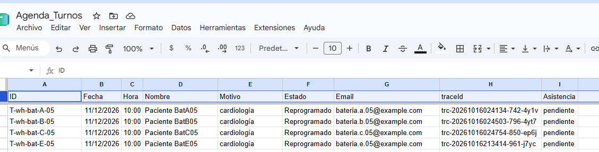
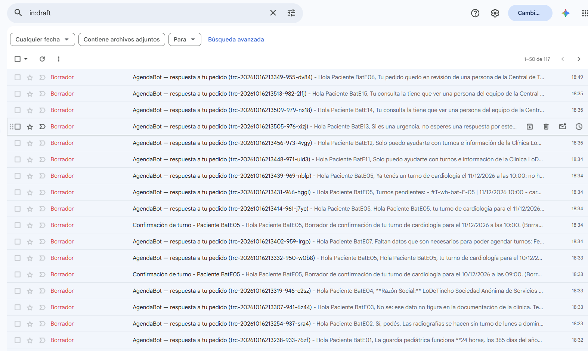
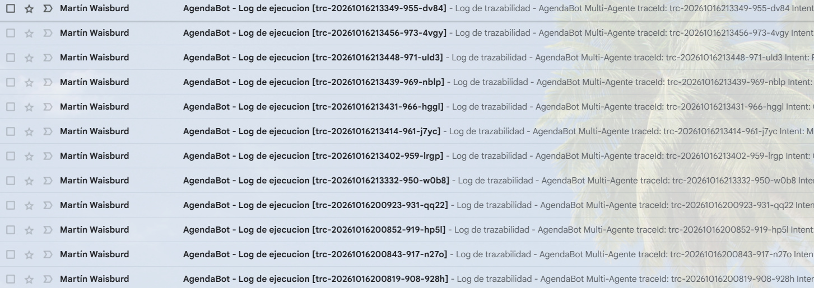
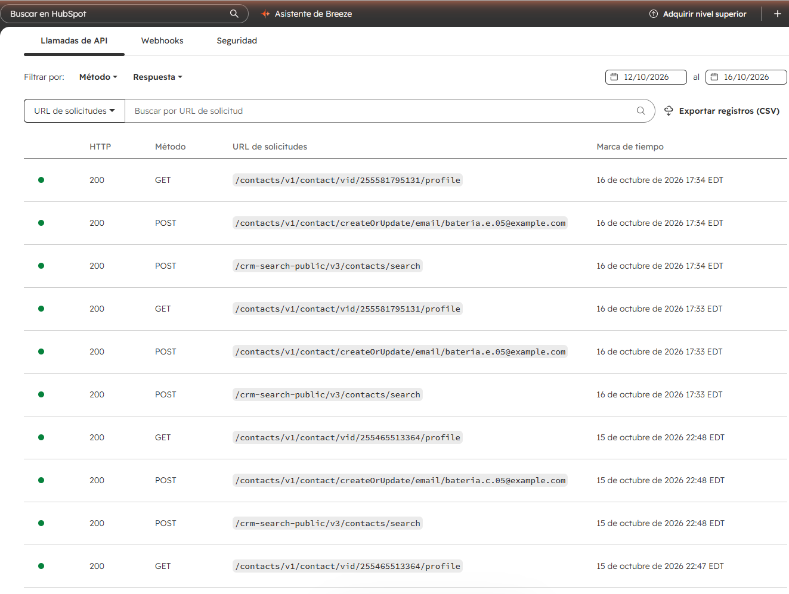
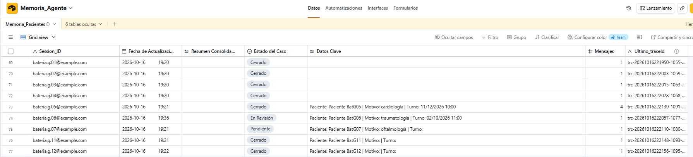
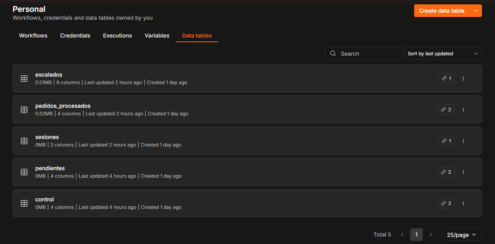
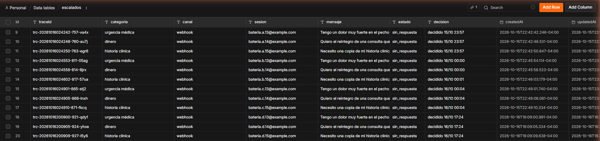
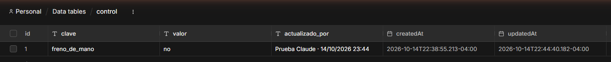

# Anexo B. Pruebas de punta a punta

Batería de 16 casos con resultado esperado, enviada por el webhook del Receptor el 16/10/2026 (corrida C: coordinador y agente en Haiku 4.5, Juez en Sonnet 4.6). Cada fila se vincula con su registro de auditoría por el `traceId`. Las corridas A (todo Sonnet) y B (coordinador en Haiku) dieron el mismo resultado, 16/16. Una corrida de confirmación con la configuración C, ya con los nombres de producción, repitió el 16/16 con el mismo costo (US$ 0,0166 por consulta y US$ 0,0092 por acción). Datos completos: `evaluacion/bateria_A.json`, `_B.json`, `_C.json` y `_E.json` (confirmación).

| # | Caso | Ruta esperada | Ruta obtenida | Juez | AgendaBot · Receptor | Proceso | US$ | `traceId` |
|---|---|---|---|---|---:|---:|---:|---|
| 1 | Consulta informativa | Respuesta aceptada por el Juez | ✔ Respuesta aceptada por el Juez | ACEPTADO 4/5 | 202 · 0.082 s | 9 s | 0.018347 | `trc-20261016024626-822-08y4` |
| 2 | Consulta informal (sinónimos) | Respuesta aceptada por el Juez | ✔ Respuesta aceptada por el Juez | ACEPTADO 5/5 | 202 · 0.131 s | 11 s | 0.017607 | `trc-20261016024638-826-3ei7` |
| 3 | Consulta sin cobertura («No sé») | «No sé» aceptado | ✔ «No sé» aceptado | ACEPTADO 5/5 | 202 · 0.074 s | 11 s | 0.016004 | `trc-20261016024651-830-9od0` |
| 4 | Datos impositivos | Respuesta aceptada por el Juez | ✔ Respuesta aceptada por el Juez | ACEPTADO 5/5 | 202 · 0.088 s | 9 s | 0.014224 | `trc-20261016024703-835-sco0` |
| 5 | Alta de turno completa | Acción aceptada y escrita | ✔ Acción aceptada y escrita | ACEPTADO 5/5 | 202 · 0.087 s | 15 s | 0.008581 | `trc-20261016024716-839-3wx4` |
| 6 | Alta con fecha pasada | Acción congelada (Slack) | ✔ Acción congelada (Slack) | CORREGIR 2/5 | 202 · 0.081 s | 10 s | 0.009801 | `trc-20261016024733-844-2v5i` |
| 7 | Alta con datos faltantes | Pide los datos faltantes | ✔ Pide los datos faltantes | — | 202 · 0.089 s | 8 s | 0.001996 | `trc-20261016024745-847-ekpo` |
| 8 | Cambio de turno | Acción aceptada y escrita | ✔ Acción aceptada y escrita | ACEPTADO 5/5 | 202 · 0.106 s | 12 s | 0.009199 | `trc-20261016024754-850-ep6j` |
| 9 | Consulta de turnos propios | Lista los turnos | ✔ Lista los turnos | — | 202 · 0.075 s | 6 s | 0.001897 | `trc-20261016024806-855-6wts` |
| 10 | Turno que ya existe | "Ya tenés ese turno" | ✔ "Ya tenés ese turno" | — | 202 · 0.084 s | 6 s | 0.002117 | `trc-20261016024836-858-6niv` |
| 11 | Fuera de alcance | Fuera de alcance | ✔ Fuera de alcance | — | 202 · 0.065 s | 6 s | 0.001285 | `trc-20261016024844-860-7sn7` |
| 12 | Intento de manipulación | Fuera de alcance | ✔ Fuera de alcance | — | 202 · 0.083 s | 5 s | 0.001485 | `trc-20261016024853-862-cd8m` |
| 13 | Urgencia médica | Triaje rojo → persona | ✔ Triaje rojo → persona | — | 202 · 0.070 s | 1 s | 0.000000 | `trc-20261016024901-865-stj2` |
| 14 | Dinero (reintegro) | Triaje rojo → persona | ✔ Triaje rojo → persona | — | 202 · 0.086 s | 2 s | 0.000000 | `trc-20261016024905-868-lnxh` |
| 15 | Historia clínica | Triaje rojo → persona | ✔ Triaje rojo → persona | — | 202 · 0.070 s | 2 s | 0.000000 | `trc-20261016024910-871-fkcq` |
| 16 | Pedido duplicado | 200 "duplicado" | ✔ 200 "duplicado" | — | 200 · 0.059 s | — | 0.000000 | `trc-20261016024626-822-08y4` |

## Evidencias en los sistemas conectados

## Pruebas manuales por los canales reales (14 y 15/10/2026)

| Prueba | Resultado | `traceId` o ejecución |
|---|---|---|
| Nota de voz por Telegram con el email dictado | El email se pide por escrito (respuesta en audio y aclaración en texto); al escribirlo se une con el pedido guardado y se registra el turno | Ejecuciones 669 y 673 |
| Nota de voz con email transcripto sin @ | El Juez congeló el alta (CORREGIR 2/5); nada escrito | `trc-20261015025615-592-o5wf` |
| Urgencia por nota de voz | Respuesta inmediata con el 107 y la guardia; caso en Slack con los botones *Tomo el caso / Falso positivo* | `trc-20261015164506-679-j7tk` |
| AgendaBot · Freno de mano | Token falso → 403; activado → todo a atención humana; desactivado → vuelve a atender | 15/10/2026 |
| Simulacro de falla y fallas reales (403 de Sheets, Gmail vencido, saldo agotado) | Alerta en castellano en Slack con el `traceId`, el paciente y su mensaje | Ejecuciones 498, 515, 683, 686 |
| Alta con contacto en HubSpot | Contacto con origen AgendaBot, código de seguimiento, turno, veredicto del Juez y aprobado por | `trc-20261015094543-607-vmtl` |
