# Anexo C. Inventario de workflows y operación

## C.1 Workflows de n8n

| Workflow | Id | Disparador | Guarda ejecuciones |
|---|---|---|---|
| AgendaBot · Receptor | `B2DUAOSmq20splvS` | Webhook `POST /webhook/agendabot` | Sí |
| AgendaBot · Canal Telegram | `XXtibnyFxPu2piNu` | Telegram | **No** (audio del paciente) |
| AgendaBot · Manager | `zLiXJWDV3i8OGJCK` | Llamada de un canal · Gmail · chat | Sí |
| AgendaBot · Worker 1 a 4 (registrar, confirmar, consultar, modificar) | `NQW5Mkmm0zJc6UJQ` · `8kgru7BieMefNVvz` · `CJKVcfkXPu6oNk8D` · `wT9rHHVpMreJFqwO` | Llamada del Manager | Sí |
| AgendaBot · Herramienta RAG | `Ukqb3UUpTZhgnULF` | Llamada del agente | Sí |
| AgendaBot · Juez (supervisor) | `x0qFeyPW15wSX0hD` | Llamada del Manager | Sí |
| AgendaBot · Escalado humano | `jdJ7DV9keYZgP5MU` | Llamada del Manager | Sí |
| AgendaBot · Respuesta de voz | `H9xkLlYia4GNS3YJ` | Llamada del Manager o del escalado | **No** (audio sintetizado) |
| AgendaBot · Errores | `UBZ3dbNmFMFuYrAR` | Error Trigger (Error Workflow del Manager, del Receptor y de los canales) | Sí |
| AgendaBot · Freno de mano | `7QEDGdClm8kswbM9` | Webhook `POST /webhook/freno-de-mano` (con token) | Sí |
| AgendaBot · Ingesta KB | `1MTk7AYPCxH8R2rh` | Manual | Sí |
| AgendaBot · Simulacro de falla | `6rEbc1LKZmGBQCIp` | Webhook (prueba de la rama de error) | Sí |

### Los especialistas por dentro

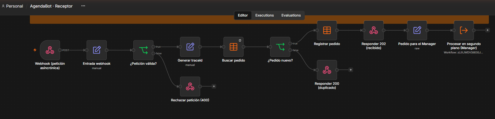

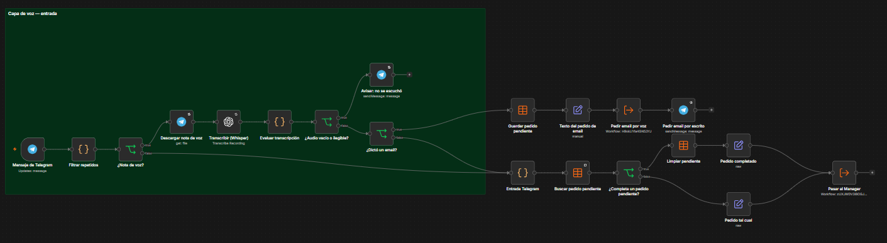

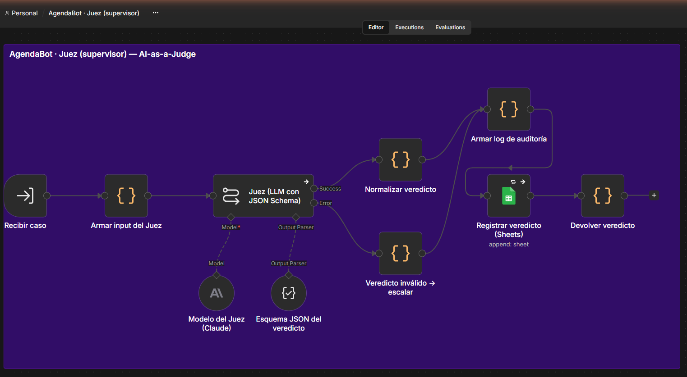

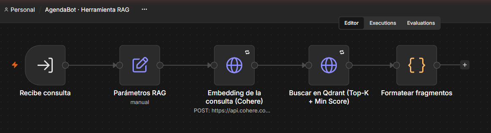

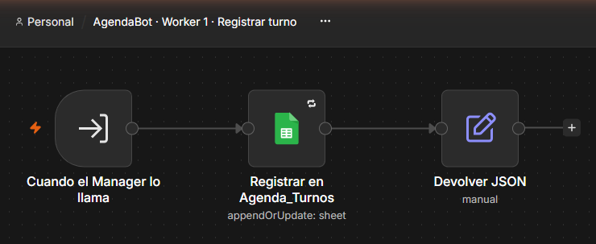

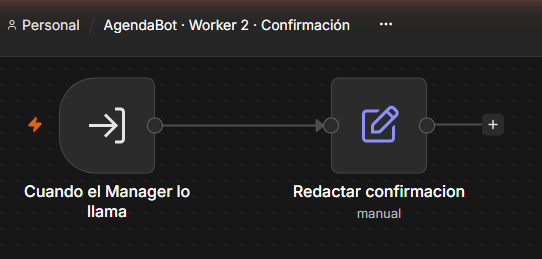

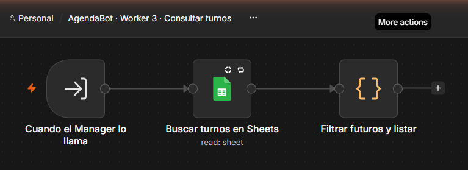

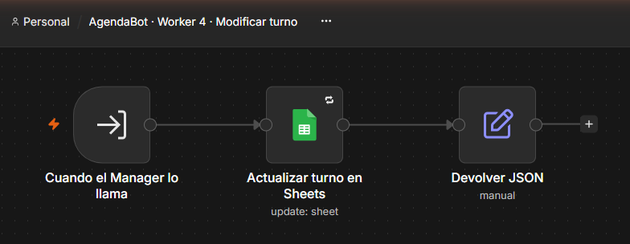

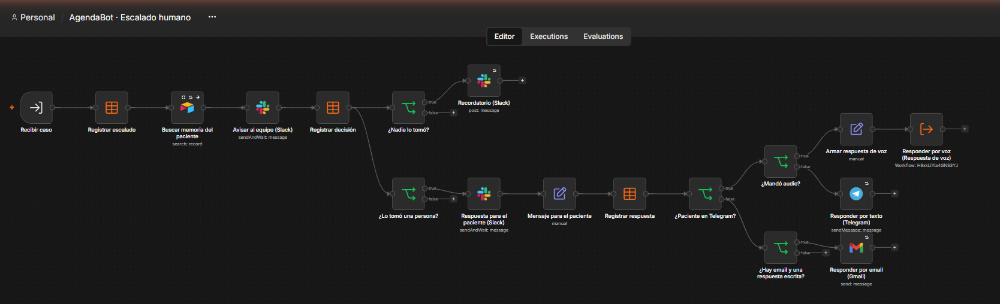

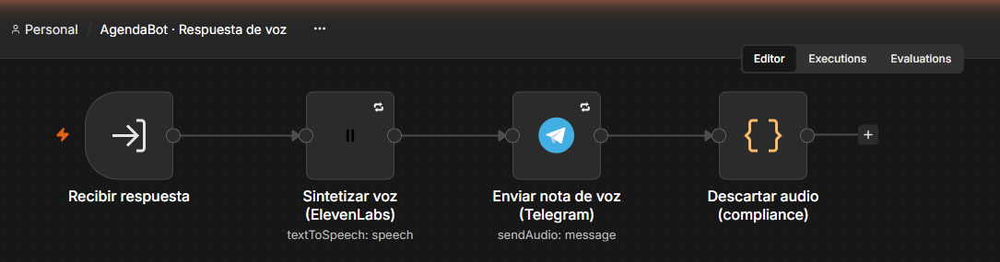

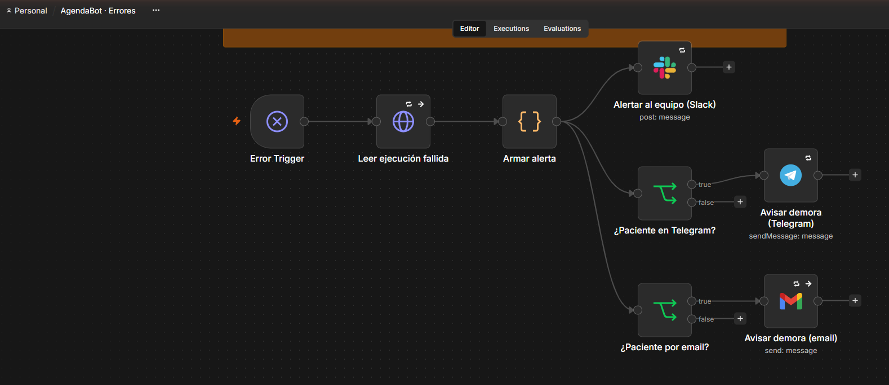

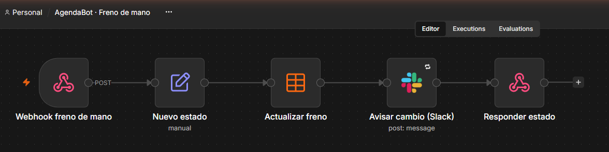

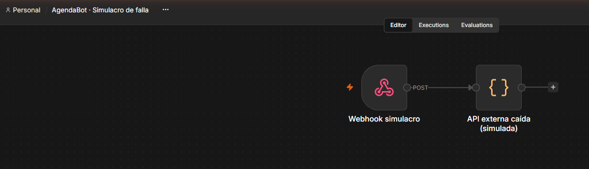

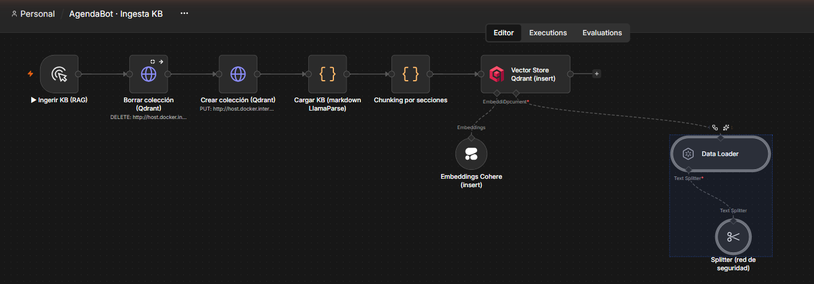

## C.2 Cómo se levanta el sistema

El sistema corre en contenedores de Docker sobre un servidor (o una computadora) con salida a internet. Levantarlo consiste en:

1. **Configuración.** El archivo `.env` (fuera del control de versiones) tiene las variables del Anexo A.1, y el almacén de credenciales de n8n, las credenciales del Anexo A.2. Las autorizaciones OAuth (Google, Slack) se renuevan desde el editor de n8n en `http://localhost:5678`.
2. **Servicios.** Se levantan tres contenedores:
   - **Qdrant**, la biblioteca oficial, en el puerto 6333;
   - **n8n**, con `WEBHOOK_URL` igual al dominio público y `N8N_EDITOR_BASE_URL` igual a la dirección local;
   - el **agente del túnel (ngrok)**, que publica n8n en el dominio fijo por el puerto 443.

   Los datos de n8n quedan en un volumen persistente.
3. **Activación.** Se publican los workflows: primero los especialistas (Workers, herramienta RAG, Juez, Escalado humano, Respuesta de voz, Errores) y al final los que tienen disparadores externos (Receptor, Canal Telegram, Freno de mano y el Manager). Al activarse, el Canal Telegram registra su dirección en Telegram y el Manager empieza a leer la casilla de Gmail.
4. **Verificación.**
   - `GET {WEBHOOK_URL}/healthz` responde 200 desde afuera;
   - los workflows figuran como activos;
   - una petición al Receptor devuelve 202 con un `traceId`, y la misma petición repetida devuelve "duplicado";
   - un mensaje de prueba por Telegram recibe respuesta;
   - el simulacro de falla genera la alerta en Slack;
   - en las Data Tables, `control` tiene `freno_de_mano = no`.
5. **Pruebas automáticas.** `scripts/probar_webhook.py` (prueba de humo) y `scripts/bateria.py` (los 16 casos del Anexo B).

## C.3 Video

Demostración de 3 minutos del flujo activo: **[enlace pendiente]**.
