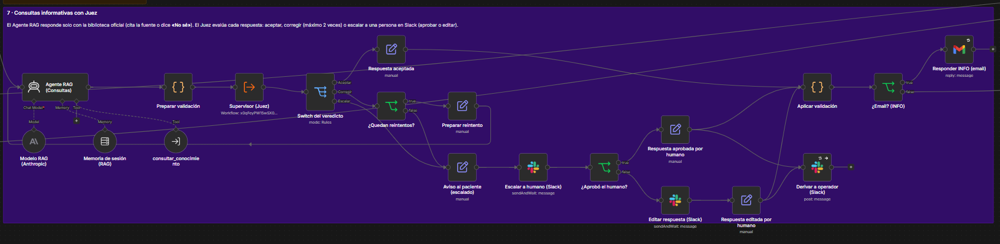

# 2. Arquitectura del sistema en n8n

## 2.1 El ecosistema: un coordinador y sus especialistas

AgendaBot no es un único flujo: son **14 workflows independientes** de n8n (versión comunitaria, en Docker). Un **Manager** coordina y delega cada tarea en un especialista: el patrón *Manager-Worker*. Cada canal de entrada es un adaptador propio y cada capacidad delicada (supervisión, escalado, voz, alertas) es un sub-workflow que se puede probar y cambiar por separado.

<svg viewBox="0 0 780 470" width="100%" xmlns="http://www.w3.org/2000/svg" font-family="Segoe UI, Arial, sans-serif">
  <defs><marker id="fl" markerWidth="8" markerHeight="8" refX="7" refY="4" orient="auto"><path d="M0,0 L8,4 L0,8 z" fill="#4b5563"/></marker></defs>
  <text x="80" y="18" text-anchor="middle" font-size="12" font-weight="700" fill="#0b3d5c">CANALES</text>
  <g font-size="10.5">
    <rect x="5" y="28" width="150" height="46" rx="8" fill="#eef2f6" stroke="#0b3d5c"/><text x="80" y="47" text-anchor="middle" font-weight="700">Receptor (webhook)</text><text x="80" y="63" text-anchor="middle" fill="#4b5563" font-size="9.5">web, app o CRM · 202 al instante</text>
    <rect x="5" y="82" width="150" height="46" rx="8" fill="#eef2f6" stroke="#0b3d5c"/><text x="80" y="101" text-anchor="middle" font-weight="700">Canal Telegram</text><text x="80" y="117" text-anchor="middle" fill="#4b5563">texto o voz (Whisper)</text>
    <rect x="5" y="136" width="150" height="40" rx="8" fill="#eef2f6" stroke="#0b3d5c"/><text x="80" y="160" text-anchor="middle" font-weight="700">Email (Gmail)</text>
    <rect x="5" y="184" width="150" height="40" rx="8" fill="#eef2f6" stroke="#0b3d5c"/><text x="80" y="208" text-anchor="middle" font-weight="700">Chat</text>
  </g>
  <g stroke="#4b5563" stroke-width="1.5" marker-end="url(#fl)"><line x1="155" y1="51" x2="218" y2="110"/><line x1="155" y1="105" x2="218" y2="122"/><line x1="155" y1="156" x2="218" y2="136"/><line x1="155" y1="204" x2="218" y2="148"/></g>
  <rect x="220" y="28" width="250" height="250" rx="12" fill="#0b3d5c"/>
  <text x="345" y="52" text-anchor="middle" font-size="14" font-weight="700" fill="#fff">MANAGER (coordinador)</text>
  <g font-size="10.5" fill="#dbe7f0">
    <text x="235" y="76">1 Entrada y formato común</text><text x="235" y="94">2 <tspan font-family="Consolas, monospace">traceId</tspan> y control de repetidos</text>
    <text x="235" y="112">3 Triaje de señales rojas y freno de mano</text><text x="235" y="130">4 Memoria del paciente y clasificación</text>
    <text x="235" y="148">5 Gestión de turnos (con Juez)</text><text x="235" y="166">6 Consulta de turnos</text>
    <text x="235" y="184">7 Consultas informativas (con Juez)</text><text x="235" y="202">8 Registro, log y memoria</text>
    <text x="235" y="220">9 Respuesta y control de comprensión</text><text x="235" y="238">10 Despacho por el canal de origen</text>
  </g>
  <text x="345" y="266" text-anchor="middle" font-size="10" fill="#9fc0d6">Error Workflow: Errores (M11)</text>
  <text x="620" y="18" text-anchor="middle" font-size="12" font-weight="700" fill="#0b3d5c">ESPECIALISTAS (sub-workflows)</text>
  <g font-size="10.5">
    <rect x="490" y="28" width="135" height="38" rx="7" fill="#fff" stroke="#0b3d5c"/><text x="557" y="44" text-anchor="middle" font-weight="700">Workers 1 a 4</text><text x="557" y="58" text-anchor="middle" fill="#4b5563" font-size="9.5">registran y consultan turnos</text>
    <rect x="635" y="28" width="140" height="38" rx="7" fill="#fff" stroke="#0b3d5c"/><text x="705" y="44" text-anchor="middle" font-weight="700">Herramienta RAG</text><text x="705" y="58" text-anchor="middle" fill="#4b5563">Top-K 5 · Min Score 0,60</text>
    <rect x="490" y="74" width="285" height="40" rx="7" fill="#fff4e5" stroke="#c2410c"/><text x="632" y="91" text-anchor="middle" font-weight="700" fill="#9a3412">Supervisor (AI-as-a-Judge)</text><text x="632" y="106" text-anchor="middle">revisa respuestas y acciones · umbral 4/5</text>
    <rect x="490" y="122" width="135" height="40" rx="7" fill="#fde8e8" stroke="#b91c1c"/><text x="557" y="139" text-anchor="middle" font-weight="700" fill="#991b1b">Escalado humano</text><text x="557" y="154" text-anchor="middle">Slack con botones</text>
    <rect x="635" y="122" width="140" height="40" rx="7" fill="#fff" stroke="#0b3d5c"/><text x="705" y="139" text-anchor="middle" font-weight="700">Respuesta de voz</text><text x="705" y="154" text-anchor="middle" font-size="9.5">ElevenLabs, sin guardar audio</text>
    <rect x="490" y="170" width="135" height="40" rx="7" fill="#fde8e8" stroke="#b91c1c"/><text x="557" y="187" text-anchor="middle" font-weight="700" fill="#991b1b">Errores</text><text x="557" y="202" text-anchor="middle">alerta en castellano</text>
    <rect x="635" y="170" width="140" height="40" rx="7" fill="#fff" stroke="#0b3d5c"/><text x="705" y="187" text-anchor="middle" font-weight="700">Freno de mano</text><text x="705" y="202" text-anchor="middle">pausa con token</text>
    <rect x="490" y="218" width="285" height="34" rx="7" fill="#fff" stroke="#9aa3ad" stroke-dasharray="4 3"/><text x="632" y="239" text-anchor="middle">Ingesta KB (manual): LlamaParse → Cohere → Qdrant</text>
  </g>
  <g stroke="#4b5563" stroke-width="1.5" marker-end="url(#fl)"><line x1="470" y1="70" x2="488" y2="50"/><line x1="470" y1="120" x2="488" y2="95"/><line x1="470" y1="150" x2="488" y2="142"/><line x1="470" y1="200" x2="488" y2="190"/></g>
  <text x="390" y="304" text-anchor="middle" font-size="12" font-weight="700" fill="#166534">HERRAMIENTAS Y DATOS</text>
  <g font-size="10.5" text-anchor="middle">
    <rect x="5" y="314" width="122" height="44" rx="7" fill="#eef7f1" stroke="#15803d"/><text x="66" y="332">Agenda de turnos</text><text x="66" y="348" fill="#4b5563">Google Sheets</text>
    <rect x="135" y="314" width="122" height="44" rx="7" fill="#eef7f1" stroke="#15803d"/><text x="196" y="332">Memoria del paciente</text><text x="196" y="348" fill="#4b5563">Airtable</text>
    <rect x="265" y="314" width="122" height="44" rx="7" fill="#eef7f1" stroke="#15803d"/><text x="326" y="332">CRM</text><text x="326" y="348" fill="#4b5563">HubSpot (metadatos)</text>
    <rect x="395" y="314" width="122" height="44" rx="7" fill="#eef7f1" stroke="#15803d"/><text x="456" y="332">Biblioteca oficial</text><text x="456" y="348" fill="#4b5563">Qdrant (195 fragmentos)</text>
    <rect x="525" y="314" width="122" height="44" rx="7" fill="#eef7f1" stroke="#15803d"/><text x="586" y="332">Data Tables (n8n)</text><text x="586" y="348" fill="#4b5563">repetidos · escalados</text>
    <rect x="655" y="314" width="120" height="44" rx="7" fill="#eef7f1" stroke="#15803d"/><text x="715" y="332">Slack · Gmail</text><text x="715" y="348" fill="#4b5563">Telegram</text>
  </g>
  <rect x="5" y="378" width="770" height="84" rx="10" fill="#f7f9fb" stroke="#0b3d5c" stroke-dasharray="5 3"/>
  <text x="390" y="398" text-anchor="middle" font-size="12" font-weight="700" fill="#0b3d5c">Correlación del <tspan font-family="Consolas, monospace">traceId</tspan> (código de seguimiento)</text>
  <g font-size="10.5" text-anchor="middle">
    <text x="390" y="418">Lo crea el Receptor (o el Manager) → viaja a cada Worker, a la herramienta RAG, al Juez y al escalado</text>
    <text x="390" y="436">→ queda en la agenda, en el contacto de HubSpot, en QA_Veredictos (11), en escalados_m11, en el log de auditoría y en cada alerta</text>
    <text x="390" y="454" fill="#4b5563">Con un solo código se reconstruye qué pidió el paciente, qué decidió el Juez, quién aprobó y qué se escribió.</text>
  </g>
</svg>

| Workflow | Función |
|---|---|
| **Receptor (M11)** | Recibe pedidos por webhook, valida, responde al instante y le pasa el pedido al Manager sin esperarlo |
| **Canal Telegram (M11)** | Recibe texto o notas de voz, transcribe (Whisper), descarta el audio, maneja el email dictado y pasa el pedido al Manager |
| **AI Automation Avanzado - M11** (Manager) | Coordina el recorrido en 10 etapas (2.2) |
| **Worker 1 a 4** | Registrar, confirmar, consultar y modificar turnos en la agenda |
| **Tool_ConsultarConocimiento** | Búsqueda en la biblioteca oficial con Top-K y puntaje mínimo |
| **SUPERVISOR_Judge** | Auditoría con rúbrica JSON de respuestas y acciones |
| **Escalado humano** | Registra el caso, avisa en Slack con botones y permite responderle al paciente |
| **Respuesta de voz** | Sintetiza y envía la nota de voz; no guarda ejecuciones |
| **Errores** | Alerta al equipo ante cualquier falla, con el `traceId` y los datos del paciente |
| **Freno de mano** | Pausa el sistema: todos los pedidos pasan a atención humana |
| **Ingesta KB** | Carga manual de la biblioteca oficial cuando cambian los documentos |

## 2.2 El recorrido de un pedido en 10 etapas

El lienzo del Manager está ordenado de izquierda a derecha en **10 etapas numeradas**, cada una en un marco con su explicación.

**1 · Entrada por canales.** Los cuatro canales llegan a un formato común (nombre, mensaje, canal, contacto). El email pasa antes por un filtro que frena las respuestas automáticas.

**2 · Trazabilidad e idempotencia.** Cada pedido recibe su `traceId` y una clave única por canal. Si la clave ya está registrada, el pedido se descarta: no se procesa ni se responde dos veces.

**3 · Seguridad: triaje y freno de mano.** Antes de cualquier modelo de IA, reglas fijas buscan señales del semáforo rojo (urgencia médica, dinero, reclamo legal, historia clínica). Ante una señal, el paciente recibe un texto fijo (en una urgencia, el 107 y la guardia 24 h) y el caso pasa a una persona. Con el freno de mano activo, todo va a atención humana.

**4 · Memoria y clasificación.** Se recupera la memoria del paciente y el coordinador clasifica el pedido (crear, modificar o consultar un turno; información; fuera de alcance) y extrae los datos.

**5 · Gestión de turnos con Juez.** La acción se resuelve contra la agenda y **el Juez la audita antes de escribir**. Si la acepta, los Workers registran o cambian el turno, se confirma, el contacto queda en HubSpot con sus metadatos y se arma el borrador de confirmación. Si la acción es dudosa, queda congelada y se aprueba o rechaza en Slack. Si faltan datos, se le pide al paciente lo que falta; el email, siempre por escrito.

**6 · Consulta de turnos.** El Worker 3 lista los turnos futuros de la persona (solo lectura).

**7 · Consultas informativas con Juez.** El agente responde solo con la biblioteca oficial, cita la fuente o dice «No sé». El Juez evalúa cada respuesta: la acepta, la manda a corregir (como máximo dos veces) o la pasa a una persona en Slack para aprobarla o editarla.

**8 · Registro y memoria.** Log de trazabilidad (si el email de log falla, una rama de error avisa a Slack y el pedido sigue), aviso a soporte y actualización de la memoria; cada 5 mensajes se resume la conversación.

**9 · Respuesta y comprensión.** Se arma la respuesta final. Si una misma persona tiene dos pedidos seguidos que el sistema no puede atender, el segundo pasa a una persona.

**10 · Despacho por el canal.** La respuesta sale por donde llegó: Telegram en voz (si el paciente habló) o en texto, el webhook (por Telegram o como borrador de Gmail), el chat o el email.

## 2.3 Asincronía e idempotencia

Un sistema externo (la web de turnos, una app o el CRM) manda `POST /webhook/agendabot-m11` con `request_id`, `mensaje`, `nombre` y `email` o `tg_chat_id`. El **Receptor responde enseguida** y le pasa el pedido al Manager **sin esperarlo**; el análisis, el Juez y el registro ocurren en segundo plano, y el resultado sale por el canal del paciente.

| Situación (medido el 16/10/2026, corrida C) | Respuesta del Receptor | `traceId` |
|---|---|---|
| Consulta nueva | **202** "recibido" en 0,082 s | `trc-20261016024626-822-08y4` |
| El mismo `request_id` reenviado | **200** "duplicado", mismo `traceId`, sin procesar | `trc-20261016024626-822-08y4` |
| Petición sin `request_id` ni canal de respuesta | **400** con la lista de datos faltantes | — |
| Promedio de las 16 peticiones | 0,083 s (máximo 0,131 s) | — |

Las capas que evitan duplicar registros y envíos:

1. **Pedido:** la clave (`wh-` + `request_id`, `tg-` + id del mensaje de Telegram, `gm-` + id del email) se busca en la Data Table `pedidos_procesados_m11` antes de procesar. La consulta y el registro tardan milisegundos, así que un reintento inmediato ya encuentra la clave.
2. **Agenda:** el Worker 1 escribe con *append or update* por ID (`T-` + clave), de modo que un reintento actualiza la misma fila en lugar de crear otra. Además, pedir un turno que ya existe responde "ya tenés ese turno; no hice cambios".
3. **CRM:** el contacto se escribe con *upsert* por email.
4. **Envíos:** un pedido repetido nunca llega a la etapa de despacho, así que no se manda dos veces la misma respuesta.

## 2.4 Memoria persistente y acople contextual

**Memoria de largo plazo** (Airtable, tabla `Memoria_M11`, una fila por paciente): `Session_ID`, fecha de actualización, resumen consolidado, estado del caso, datos clave (paciente, motivo, turno), contador de mensajes y último `traceId`. Recorrido:

1. **Lectura:** se busca la fila del paciente por `Session_ID` (su email o su chat de Telegram).
2. **Paciente nuevo:** se crea la fila con *upsert*, sin campos vacíos que se inyecten en el prompt.
3. **Contexto:** el coordinador recibe el resumen y los datos clave; el agente de consultas, solo lo necesario para entender la pregunta.
4. **Conteo:** cada mensaje suma uno.
5. **Resumen:** al pasar los 5 mensajes, un modelo económico (Haiku 4.5) resume la conversación en JSON.
6. **Actualización:** *upsert* por `Session_ID`, sin duplicar filas.

**Memoria de sesión:** las últimas interacciones de la conversación, separadas para el coordinador y para el agente de consultas. Así el agente no arrastra contexto que no le corresponde.

**Contratos de datos entre especialistas.** Cada sub-workflow recibe solo los campos que necesita (un nodo *Set* antes de cada delegación los filtra y agrega el `traceId`) y devuelve una salida uniforme. Si un sub-workflow falla, la ejecución se corta y la rama de error avisa al equipo (2.5).

| Sub-workflow | Recibe (obligatorio) | Devuelve | Destinatario |
|---|---|---|---|
| Receptor | `request_id`, `mensaje` (texto), `email` o `tg_chat_id`; opcional `nombre` | 202 `{estado, `traceId`, request_id, detalle}` · 200 "duplicado" · 400 `{estado, faltan[]}` | Sistema externo y Manager |
| Worker 1 (alta) | `traceId`, `idemKey`, `nombre`, `motivo`, `fecha` (dd/mm/aaaa), `hora` (hh:mm), `email` | `{`traceId`, status: "success", data: {id, nombre, fecha, hora, motivo, estado, email}}` | Manager → Worker 2 |
| Worker 4 (cambio) | `traceId`, `id` del turno, nueva `fecha` y/o `hora` | Igual que el Worker 1, con estado "Reprogramado" | Manager → Worker 2 |
| Worker 2 (confirmación) | Datos del turno confirmado | `{data: {mensaje}}` | Manager → paciente |
| Worker 3 (consulta) | `traceId`, `nombre` | `{data: {mensaje}}` con la lista de turnos futuros | Manager → paciente |
| Herramienta RAG | `consulta` (texto) | Fragmentos con fuente, sección y puntaje, o `SIN_RESULTADOS` | Agente de consultas |
| Juez | `tipo_caso` (RESPUESTA o ACCION), `pregunta`, `respuesta`, fragmentos o acción propuesta, agenda y fecha | `{exactitud_factual: 1..5, estado_veredicto: ACEPTADO / CORREGIR / RECHAZADO, critica, ruta}` | Manager (sigue, corrige o congela) |
| Escalado humano | `traceId`, `categoria`, `canal`, `sessionId`, `mensaje`, `respuesta_fija`, contacto | Registro en `escalados_m11` y decisión de la persona | Equipo en Slack → paciente |
| Respuesta de voz | `texto_voz` (máx. 200 caracteres), `tg_chat_id` | `{enviado, audio_destruido: true}` | Paciente (Telegram) |

## 2.5 Robustez: qué pasa cuando algo falla

- **Reintentos:** cada API externa (Sheets, HubSpot, Airtable, Gmail, Slack, Telegram, modelos, Cohere, Qdrant) se reintenta 3 veces, con 2 segundos entre intentos.
- **Error Workflow:** cualquier falla del Manager, del Receptor o de un canal dispara **Errores (M11)**. Este workflow recupera la ejecución fallida, avisa en Slack **en castellano** (qué pasó, dónde, quién es el paciente, su mensaje y el `traceId`) y le avisa al paciente que hay demoras, por Telegram o por email.
- **Rama de error visible:** si falla el email de log, una rama avisa a Slack y el pedido sigue su curso.
- **Falla segura:** una acción congelada que nadie aprueba en 15 minutos **no se ejecuta**. El paciente recibe "tu pedido quedó en revisión".
- **Simulacro:** el workflow *Simulacro de falla (M11)* permite probar la alerta en cualquier momento.

**Fallas reales durante las pruebas y cómo respondió el sistema:**

| Qué pasó | Qué hizo el sistema | Qué se corrigió |
|---|---|---|
| Las planillas nuevas no estaban compartidas con la cuenta de n8n (Google respondió 403) | Alerta en Slack con el `traceId` y el paciente | Se compartieron las planillas con la cuenta de Google que usa n8n |
| Venció la autorización de Gmail | Alerta; el log falló pero el pedido siguió por la rama de error | Se reconectó la credencial; el retorno de OAuth quedó en localhost |
| Se agotó el saldo de la API de IA | Alerta: "Sin saldo en la API del proveedor de IA: hay que cargar crédito"; el triaje y las alertas siguieron andando | Se cargó crédito; se agregó la traducción de errores |
| La red pública bloqueó el túnel de Cloudflare | Telegram dejó de recibir; el resto siguió | Túnel con dominio fijo (ngrok, puerto 443) que se reconecta solo |
| Corte de red mientras una acción esperaba aprobación | La acción no se ejecutó (falla segura) | — |

## 2.6 La biblioteca oficial, con disciplina

- **Fuente única:** 16 documentos oficiales de la clínica, procesados con LlamaParse, divididos por secciones con su ruta de títulos (195 fragmentos) e indexados en Qdrant con embeddings de Cohere. Los datos de la razón social y fiscales se reemplazaron por datos ficticios (anonimización).
- **Búsqueda con umbral:** se devuelven los 5 fragmentos más parecidos (Top-K 5), pero **solo si superan un puntaje de 0,60**. Si ninguno lo supera, el agente responde **«No sé: ese dato no figura en la documentación de la clínica»** en lugar de inventar.
- **Citas con metadatos reales:** cada respuesta cierra con `[Fuente: documento — sección]`, tomada del fragmento recuperado.

**Equivalencia con el nodo nativo** (devolución de la P5):

| | *Vector Store Retrieve Tool* nativo de n8n | Herramienta implementada (`Tool_ConsultarConocimiento`) |
|---|---|---|
| Nombre y descripción para el agente | Sí | Sí ("consultar_conocimiento") |
| Top-K | Sí | Sí (5) |
| Puntaje mínimo | **No disponible** | **Sí (0,60)**: por esto se implementó como sub-workflow |
| Conexión al índice | Qdrant | Qdrant (`kb_lodetincho_m5`), por su API de búsqueda |
| Salida | Fragmentos | Fragmentos con fuente, sección y puntaje, o `SIN_RESULTADOS` |
