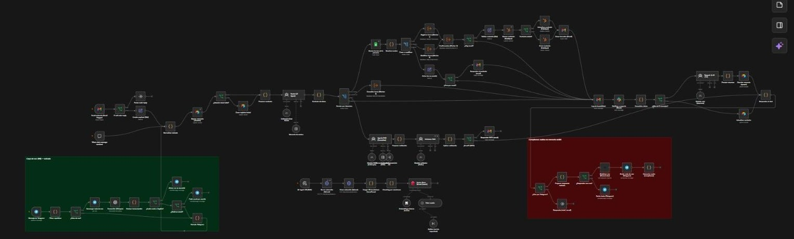
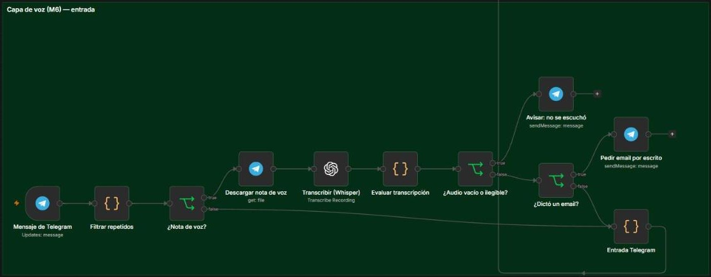
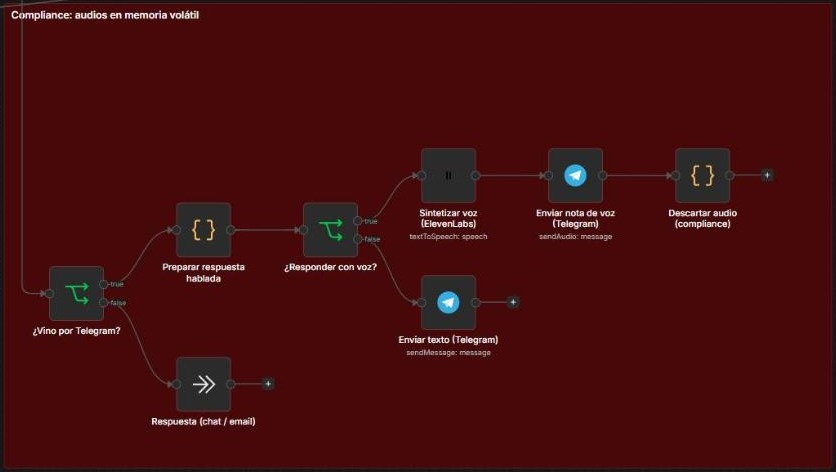

# 2. Arquitectura del circuito cerrado de voz

El M6 **no arranca de cero**: es el Manager del M5 (multi-agente + memoria + integraciones + RAG con validador) duplicado y apuntado a los recursos 06 (`Agenda_Turnos (06)`, tabla `Memoria_M6`), al que se le sumó **Telegram como un canal más**, junto al chat y al email. El circuito es cerrado: entra una nota de voz y sale una nota de voz.

```
Telegram ─► filtro de repetidos ─► ¿nota de voz? ─► descargar audio ─► Whisper (data, es)
   ─► contingencia (vacío / alucinación / email dictado) ─► Manager M5 (Router → workers o RAG + validador)
   ─► respuesta hablada (≤ 200 car.) ─► ElevenLabs (Multilingual v2) ─► Telegram Send Audio ─► descartar audio
```



**Entrada de voz** (zona verde): trigger de Telegram, Whisper y la ruta de contingencia; después el mensaje entra al Manager como canal `telegram_voz`.



**Salida de voz** (zona roja): si el pedido vino por Telegram, la respuesta se prepara para el oído, se sintetiza y se envía como audio; si vino por chat o email, sigue como en el M5.


