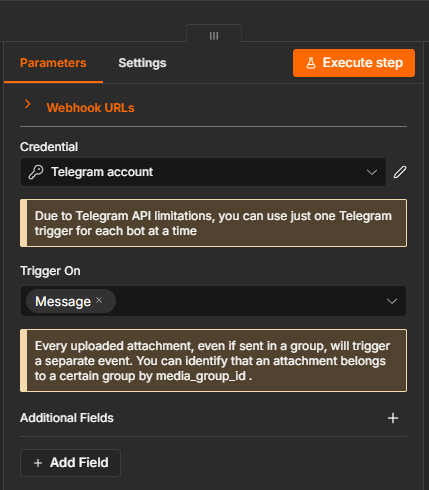
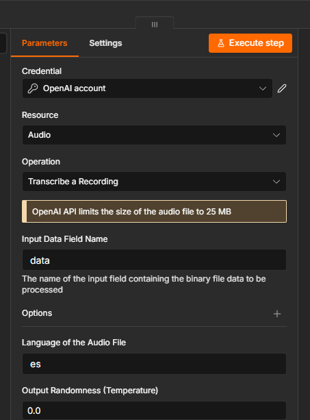

# 3. Interceptación binaria, oídos (Whisper) y cerebro (AI Agent)

**Trigger de Telegram.** Un bot oficial creado con @BotFather; el nodo *Telegram Trigger* escucha `message` y recibe las notas de voz en tiempo real. n8n corre en local y se expone a Telegram con un túnel HTTPS de Cloudflare (`WEBHOOK_URL` apunta al túnel), el mismo esquema que mostró la demo de la clase.

**Whisper.** Telegram no entrega el audio dentro del evento sino un `file_id`: por eso, entre el trigger y Whisper, hay un IF que separa voz de texto y un *Telegram › Get File* que descarga la nota de voz como binario `data` (igual que en la demo de la clase). El nodo *OpenAI › Audio › Transcribe a Recording* tiene mapeado **`data`** en *Input Data Field Name* y el idioma fijado en **`es`**, para que no gaste tiempo detectando el idioma. Temperatura 0.

**Cerebro.** El texto transcrito entra al Manager por "Normalizar entrada" como canal `telegram_voz` y llega al **Router (AI Agent)**: el mismo nodo agéntico del M5 (AI Agent v3.1, que en esta versión de n8n trabaja como *Tools Agent*), con memoria de Airtable, que deriva a los workers de turnos o al Agente RAG. Así, una nota de voz puede sacar un turno o consultar la base documental igual que un mensaje escrito.
