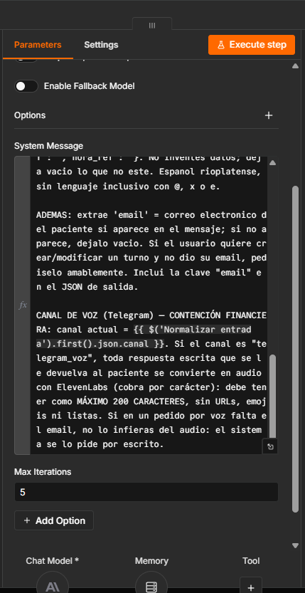

# 4. Contención financiera: máximo 200 caracteres

La regla está **escrita en el System Message** del agente central (Router) y del Agente RAG, que es el que redacta las respuestas informativas. Se activa cuando el canal es `telegram_voz`:

> CANAL DE VOZ (Telegram) — CONTENCIÓN FINANCIERA: […] toda respuesta escrita que se le devuelva al paciente se convierte en audio con ElevenLabs (cobra por carácter): debe tener como **MÁXIMO 200 CARACTERES**, sin URLs, emojis ni listas.

En el Agente RAG la regla agrega pautas de diseño para el oído de la unidad 6: frases cortas (sujeto + verbo + predicado), puntos seguidos para marcar pausas y, si el dato es una lista larga, nombrar los primeros y ofrecer el resto por escrito.

**Segunda barrera en código.** El nodo "Preparar respuesta hablada" saca del texto lo que no debe leerse en voz alta (citas `[Fuente: …]`, URLs, markdown, viñetas, emojis) y, si aun así pasa de 200 caracteres, corta en el último fin de oración. Así el tope se cumple aunque el modelo no lo respete.

| Prueba | Caracteres enviados a ElevenLabs |
|---|---|
| Confirmación de turno (tomografía) | 87 |
| Profesionales de Cardiología (RAG) | 134 |
| Pregunta fuera de alcance | 106 |
