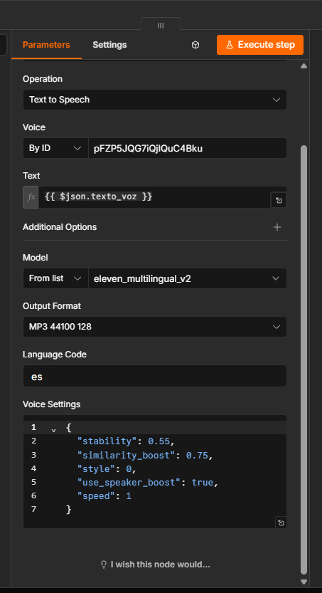
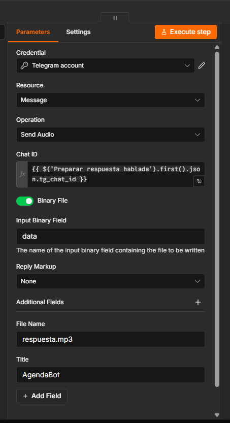

# 5. Voz del agente (ElevenLabs) y salida multimedia

**ElevenLabs.** Se usa el nodo oficial de ElevenLabs para n8n (paquete `@elevenlabs/n8n-nodes-elevenlabs`, publicado por ElevenLabs; n8n 2.39 no lo trae de fábrica), operación *Speech › Text to Speech*, con el texto `{{ $json.texto_voz }}` que dejó la pieza 4.

- **Modelo:** `eleven_multilingual_v2` (Eleven Multilingual), idioma `es`.
- **Stability 0,55 y Clarity (similarity_boost) 0,75:** perfil de **voz de soporte** de la guía de la unidad 2 (estabilidad media, tono cálido) para una clínica. En este nodo los controles no son sliders: se cargan en el JSON *Voice Settings* con los mismos valores.
- **Formato:** MP3 44,1 kHz 128 kbps.

**Salida.** *Telegram › Send Audio* con *Binary File* activado toma el binario **`data`** que generó ElevenLabs y lo envía al mismo chat del paciente (`tg_chat_id`), como `respuesta.mp3`. En las pruebas, los audios enviados duraron 6 s (confirmación de turno) y 10 s (consulta de Cardiología).

Si el pedido llegó por **texto** de Telegram, la respuesta sale por *Send Message* (texto completo, sin recorte): la voz se reserva para quien habló.
