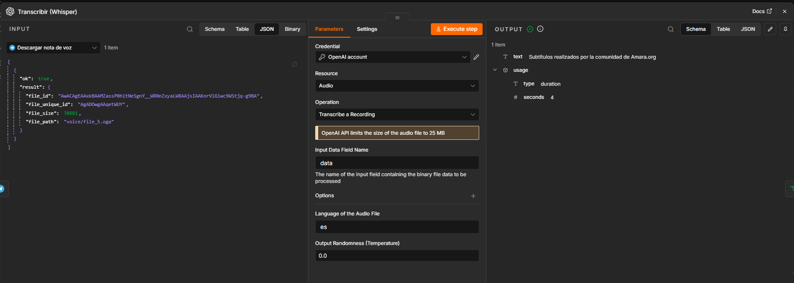
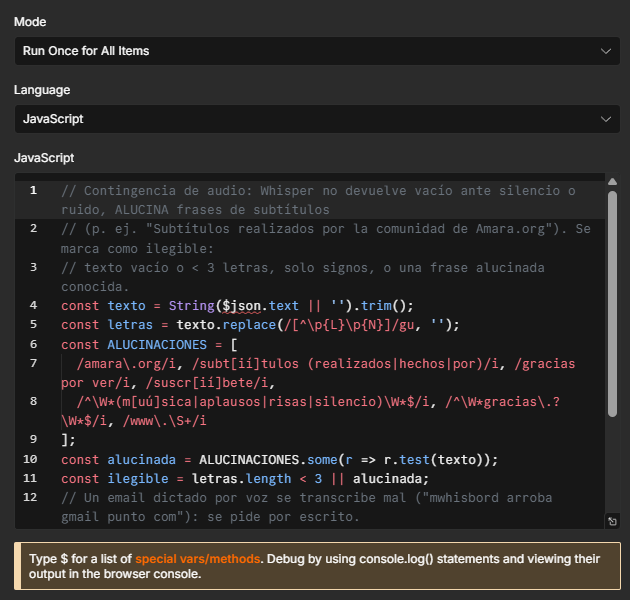

# 6. Ruta de contingencia no-code

**Hallazgo:** ante una nota de voz en silencio, Whisper **no devuelve texto vacío: inventa una frase**. En la prueba devolvió *"Subtítulos realizados por la comunidad de Amara.org"*, una alucinación típica del modelo (aprendió esas leyendas de subtítulos). Un IF que solo mirara "texto vacío o menor a 3 caracteres", como sugiere el material, la habría dejado pasar al agente.

Por eso, inmediatamente después de Whisper, el nodo **"Evaluar transcripción"** marca el audio como ilegible si:

- el texto está vacío, tiene menos de 3 letras o solo signos;
- coincide con una alucinación conocida de Whisper ("Amara.org", "Subtítulos realizados por…", "Gracias por ver", "[Música]", "Gracias." suelto).

El IF **"¿Audio vacío o ilegible?"** desvía esos casos a un mensaje de texto: *"Perdón, no logré escuchar tu audio con claridad. ¿Podés grabarlo de nuevo en un lugar con menos ruido, o escribirme tu consulta?"*. El flujo no se rompe y el agente no responde a una frase fantasma.

**Otras contingencias, surgidas de las pruebas:**

- **Email dictado.** El paciente dictó *"mwaisburd arroba gmail.com"* y Whisper lo transcribió como *"mwhisbord arroba gmail.com"*, así que el turno quedó con un correo inválido. Si la nota de voz contiene un email ("arroba", "@", "punto com"), el bot responde *"Para no anotar mal tu email, ¿me lo escribís por texto?"*. La regla se verificó con casos de prueba del nodo, no con un audio en vivo.
- **Mensajes repetidos.** Telegram reintentó tres veces la entrega del mismo mensaje (mismo `update_id`). El nodo "Filtrar repetidos" procesa cada `update_id` una sola vez.
- **Fuera de alcance.** Una pregunta ajena a la clínica respondía "Listo." (heredado del M5); ahora responde *"Solo puedo ayudarte con turnos e información de la Clínica LoDeTincho. Esa consulta no la puedo responder."*.
