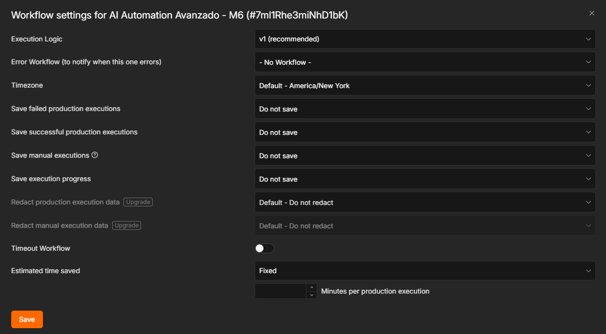

# 7. Compliance: audios en memoria volátil y destrucción

**Diseño:** las notas de voz de los pacientes y los audios sintetizados existen solo mientras corre la ejecución; ninguna queda guardada en n8n ni sale del flujo.

1. **El workflow no guarda ejecuciones.** En *Workflow settings*: ejecuciones exitosas, fallidas y manuales en **Do not save**, y sin guardar el progreso. n8n 2.x ya no tiene un modo de binarios "solo en memoria" (los guarda en disco durante la ejecución), pero borra esos archivos al cerrar una ejecución que no se guarda.
2. **"Descartar audio (compliance)"** es el último nodo: devuelve solo metadata (`enviado`, `chat_id`, `audio_destruido: true`), sin binario.
3. **Ningún audio se sube** a Drive, Airtable ni a otro almacenamiento: la memoria del paciente guarda el resumen del texto, nunca el audio.
4. **La nota roja del lienzo** agrupa los nodos de salida y de compliance (ver captura de la pieza 2).

**Verificación.** Con los settings aplicados se ejecutó una consulta y se comprobó que n8n no registró la ejecución ni creó una carpeta nueva de binarios en el almacenamiento de n8n.

**Datos sensibles del canal.** La clave del bot y las API keys viven en las credenciales cifradas de n8n; los JSON exportados del workflow no las contienen.
