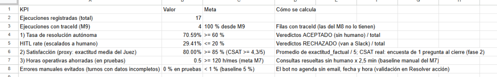

# Dimensión 1 — Planificación financiera y economía del token

**Sistema:** AgendaBot, la central de turnos con IA de la Clínica LoDeTincho (nombre anonimizado). Es el mismo agente del Módulo 8: Manager multi-agente, Agente RAG, **Juez** (AI-as-a-Judge) y escalado humano en Slack. **Punto de partida:** el coste proyectado del M8 para 1.000 consultas informativas: **US$ 21,84** con el agente en Claude Sonnet 4.6 y **US$ 10,84** con Claude Haiku 4.5 (en los dos casos, agente + Juez).

> **Supuestos** (no son datos reales de la clínica): el volumen y los tiempos manuales son el *baseline* del M7; $ 10.000 por hora administrativa y $ 20.000 por hora técnica; **US$ 1 = $ 1.400**; 22 días hábiles. Los costes por ejecución son **medidos** (M8 y pruebas del M9).

## KPIs para la dirección

Se leen en la pestaña **KPIs** de `QA_Veredictos (09)`, que es el tablero del M8 con fórmulas sobre los veredictos que registra el Juez.

| KPI | Cómo se mide | Hoy (pruebas) | Meta del piloto |
|---|---|---|---|
| **1. Tasa de resolución autónoma** | Veredictos ACEPTADO (sin humano) / total | **70,6 %** | ≥ 60 % |
| **2. Satisfacción del paciente** | Proxy: exactitud media del Juez / 5. En la fase 2, encuesta de una pregunta al cerrar la conversación | **80 %** | ≥ 85 % (CSAT ≥ 4,3/5) |
| **3. Tiempo operativo ahorrado** | Gestiones resueltas sin humano × minutos del baseline | 183 h/mes (proyección) | ≥ 120 h/mes (meta M7) |
| Reducción de errores manuales | Turnos con datos incompletos o duplicados | 0 en pruebas: no agenda sin nombre, fecha, hora y email | < 1 % (baseline 5 %) |

## ROI contra el baseline manual (por mes)

| Tarea automatizada | Volumen | Min/gestión | Horas manuales | Autonomía esperada | Horas evitadas | Ahorro |
|---|---|---|---|---|---|---|
| Sacar un turno nuevo | 1.540 | 4 | 102,7 | 80 % | 82,1 | $ 821.333 |
| Modificar o cancelar un turno | 836 | 3 | 41,8 | 70 % | 29,3 | $ 292.600 |
| Consulta informativa (RAG) | 1.584 | 2,5 | 66,0 | 70 % (medido) | 46,2 | $ 462.000 |
| Confirmación o recordatorio | 1.540 | 1 | 25,7 | 100 % | 25,7 | $ 256.667 |
| **Total** | **5.500** | | **236,2** | | **183,3** | **$ 1.832.600** |

| Caso de negocio (mensual) | Monto |
|---|---|
| Beneficio: horas administrativas evitadas | $ 1.832.600 |
| TCO (tabla siguiente) | $ 351.660 |
| **Beneficio neto** | **$ 1.480.940** |
| **ROI mensual** (neto / TCO) | **4,2 veces** |
| Implementación: 80 h técnicas × $ 20.000 (una sola vez) | $ 1.600.000. **Se recupera en 1,1 meses** |

**Picos de demanda.** Si un lunes llegan el doble de pedidos (250 gestiones más), el bot los absorbe por unos **US$ 2,82** de tokens (≈ $ 3.950), sin espera. A mano serían unas 10,7 horas extra (≈ $ 107.000) y la espera en picos subiría de los 6 minutos actuales.

## Matriz de Costo Total de Operación (TCO mensual)

Volumen: **6.336 ejecuciones del Manager por mes**: 1.584 consultas informativas (Router + Agente RAG + Juez) y 4.752 mensajes de gestión de turnos (solo Router). Se supone que cada gestión lleva dos mensajes.

| Rubro | US$/mes | $/mes | Base |
|---|---|---|---|
| Tokens de Claude (Router, Agente RAG, Juez, resumen) | 68,90 | 96.460 | medido × volumen |
| Whisper (transcripción, 10 % de mensajes por voz) | 1,90 | 2.660 | US$ 0,006/min |
| ElevenLabs (voz, plan Creator) | 22,00 | 30.800 | respuestas de 200 caracteres como máximo |
| Embeddings de Cohere (búsquedas RAG) | 0,10 | 140 | |
| Qdrant Cloud (195 fragmentos) | 0 | 0 | plan gratuito (1 GB) |
| n8n self-hosted (VPS) | 24,00 | 33.600 | supuesto |
| Airtable Team (1 editor) | 20,00 | 28.000 | supuesto |
| Gmail, Sheets, Slack, HubSpot CRM, Telegram | 0 | 0 | planes existentes o gratuitos |
| Mantenimiento técnico (8 h) | | 160.000 | supuesto |
| **Total** | **136,90** | **$ 351.660** | |

**El coste de una consulta depende de cuántas vueltas da el agente** (US$ por consulta informativa, medido):

| Escenario | US$ por consulta |
|---|---|
| Optimista: una sola vuelta | 0,0222 |
| Realista: una búsqueda y el Juez | 0,0266 |
| Fat loop: dos reintentos del Juez | 0,0702 |

El techo lo ponen los guardrails: **máximo 5 iteraciones** por agente y **máximo 2 reintentos** del Juez.

### Contención del gasto (no técnica)

| Estrategia | Dónde | Efecto |
|---|---|---|
| **Contexto acotado (RAG)** | El agente recibe solo los 5 fragmentos más relevantes (score mínimo 0,60), no el manual entero | ~1.500 tokens en lugar de **23.226** (manual completo, medido) |
| **Prompt Caching** (Anthropic) | Agente RAG: opción *Prompt Caching 5 min* del nodo de Claude. El bloque fijo del prompt va **primero** y la memoria del paciente **al final** (antes iba al principio y rompía el caché) | **−22 %** de la entrada por intento (la 2.ª llamada del loop lee el prefijo de la 1.ª) |
| **Model routing** | El resumen de memoria pasó de Sonnet 4.6 a Haiku 4.5. Recomendación del M8: agente RAG en Haiku 4.5 | Tokens: US$ 79,36 (M8) → **US$ 68,90 (M9)** → US$ 52,99 con Haiku (−33 %) |
| **Límites del loop** | AI Agent: *Max Iterations* = 5; Juez: máximo 2 reintentos; voz: 200 caracteres como máximo | El *fat loop* no supera US$ 0,07 por consulta |

**Prompt Caching: precios y medición.** Precios de lista por millón de tokens: Sonnet 4.6, US$ 3 de entrada y US$ 15 de salida; Haiku 4.5, US$ 1 y US$ 5. Escribir en caché cuesta **1,25×** la entrada con TTL de 5 minutos (2× con TTL de 1 hora); leer del caché cuesta **0,1×**. Medido con la API, cada escenario con dos pedidos seguidos:

| Bloque fijo cacheado | Tokens | 2 pedidos sin caché | 2 pedidos con caché |
|---|---|---|---|
| Prompt fijo del Agente RAG | 1.077 | US$ 0,0084 | US$ 0,0063 (−25 %) |
| Manual completo de la clínica (16 documentos) | 23.226 | US$ 0,1413 | US$ 0,0960 (−32 %) |

Con 1.000 lecturas, el manual cacheado costaría US$ 7,05 en lugar de US$ 69,68 (**−90 %**). Aun así conviene más **no mandarlo** y usar RAG.

**Dónde no conviene el caché:**

- **En el Juez.** Hace una sola llamada por caso y su rúbrica fija (~780 tokens) no llega al mínimo cacheable de Sonnet 4.6 (1.024 tokens). Solo pagaría el recargo de escritura.
- **En Haiku 4.5.** Exige 4.096 tokens como mínimo, así que el prompt actual no se cachearía. La elección de modelo se hace por **coste total**, no por el caché.

## Control preventivo de API Keys

| | Desarrollo | Producción |
|---|---|---|
| Dónde corre | n8n local (este proyecto) | n8n en VPS |
| Anthropic (Console › Workspaces) | Workspace `agendabot-dev`, **límite de gasto US$ 10/mes** | Workspace `agendabot-prod`, límite de US$ 150/mes (≈ 2× el TCO de tokens) y alertas al 50, 80 y 100 % |
| OpenAI (Whisper, Projects › Limits) | Proyecto `agendabot-dev`, **presupuesto de US$ 5/mes** | Proyecto `agendabot-prod` con presupuesto y alerta |
| ElevenLabs y Cohere | Key con tope de créditos / key de prueba | Key de producción con tope mensual de caracteres |
| Credenciales en n8n | `Anthropic DEV`, `OpenAI DEV`… La instancia de desarrollo **solo tiene las DEV** | `… PROD`, solo en la instancia de producción |

Si un bucle infinito aparece mientras se prueba, choca contra el tope de US$ 10 de la key de desarrollo y no toca el presupuesto de producción. Las keys viven en las *Credentials* de n8n, nunca en los prompts ni en nodos Code. **Estado actual:** el proyecto todavía corre solo en desarrollo, con una key por proveedor. La separación y los topes se configuran en cada consola antes de pasar a producción.
