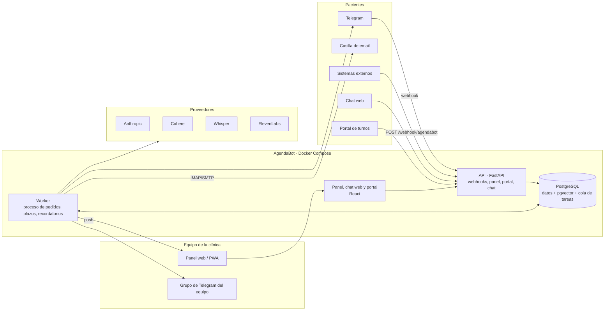
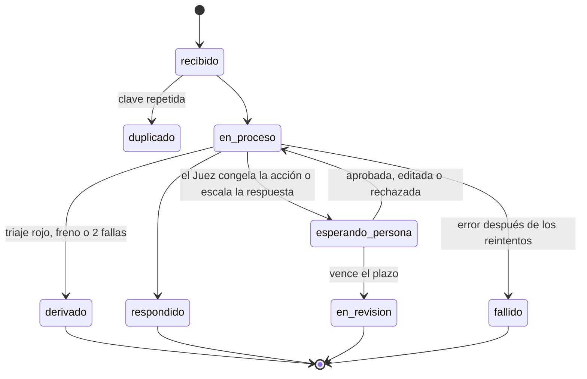

# Plan: AgendaBot como sistema web propio sobre PostgreSQL

Reemplazo total de los 15 workflows "AgendaBot · …" del Proyecto Final (n8n) por un sistema web propio.

Fecha del plan: 26/10/2026. Relevamiento hecho sobre las exportaciones de `Avanzado/Modulo11/workflows/` (al día al 20/10/2026).

---

## 0. Resumen

**Qué se construye.** Un sistema con dos partes:
- **Backend en Python (FastAPI):** recibe los pedidos de todos los canales, corre el mismo proceso que hoy hace el Manager (triaje, memoria, clasificación, agenda, Juez, respuesta) y guarda **todo** en PostgreSQL.
- **Panel web (React):** el equipo de la clínica trabaja ahí. Reemplaza a Slack, Sheets, Airtable, HubSpot y las Data Tables.

Los pacientes siguen escribiendo por Telegram y por email, y suman un chat web y un portal donde ven y gestionan sus turnos.

**Decisiones de partida** (respuestas del 26/10/2026):

| Tema | Decisión |
|---|---|
| Dónde corre | Local en Docker (LOBO/WOLVERINE), diseñado para pasar a un servidor con dominio sin reescribir |
| Tecnología | Python (FastAPI) en el backend; React en el panel, el chat web y el portal |
| IA | Anthropic, Whisper, ElevenLabs y los embeddings de Cohere siguen como APIs; todo lo demás es propio, incluida la base vectorial (pgvector) |
| Agenda | Paridad con lo de hoy **más** una agenda real: profesionales, especialidades, horarios y disponibilidad |
| Equipo de la clínica | Todo se resuelve en el panel; los avisos llegan como notificación del navegador o del celular (PWA) y a un grupo de Telegram del equipo. Sin Slack |
| Migración | Gradual, canal por canal, con la batería de 16 casos como control antes de cada paso |
| Paciente | Chat web propio y portal de turnos con acceso por enlace al email |

**Qué deja de usarse y qué queda afuera:**

| Hoy | En el sistema nuevo |
|---|---|
| n8n (15 workflows, 226 nodos funcionales) | Backend propio: API y worker |
| Google Sheets `Agenda_Turnos` | Tablas de agenda en PostgreSQL, con reglas de disponibilidad |
| Google Sheets `QA_Veredictos` | Tabla `veredictos` y pantalla de calidad en el panel |
| Airtable `Memoria_Pacientes` | Tablas de pacientes y memoria |
| HubSpot (contactos y propiedades `agendabot_*`) | CRM propio dentro del panel |
| Slack #soporte (aprobaciones, escalados, alertas) | Bandeja del panel más avisos push y por Telegram |
| Data Tables de n8n (5) | Tablas de PostgreSQL con restricciones de unicidad |
| Qdrant | pgvector dentro de la misma base |
| Borradores de Gmail | Bandeja de borradores en el panel; el envío sale por SMTP |
| **Sigue siendo externo** | Telegram (canal), casilla de email (canal), Anthropic, Cohere, Whisper y ElevenLabs |

**Esfuerzo estimado:** entre 48 y 70 jornadas de trabajo, en 8 fases (detalle en la sección 8). n8n sigue atendiendo hasta que cada canal pasa la batería en el sistema nuevo.

**Costo operativo:** baja de US$ 127,91 a unos US$ 107,91 por mes (−16 %), porque desaparece Airtable Team. El resto se mantiene (sección 11).

---

## 1. Hallazgos del relevamiento que el sistema nuevo corrige

Leyendo los workflows nodo por nodo aparecieron problemas que hoy no se ven en la batería. El sistema nuevo no los copia:

| # | Hallazgo | Riesgo | Corrección en el sistema nuevo |
|---|---|---|---|
| H1 | La consulta y el cambio de turnos buscan en la agenda **por nombre** (`Buscar turnos de la persona` y el Worker 3 filtran por la columna `Nombre`) | Cualquiera que escriba "Soy Juan Pérez, ¿qué turnos tengo?" ve o cambia los turnos de otra persona con ese nombre | Los turnos se buscan por la **identidad del paciente**: email del canal o chat de Telegram vinculado y verificado. El nombre solo sirve para mostrar |
| H2 | El webhook `POST /webhook/agendabot` **no tiene autenticación** (solo valida campos) | Cualquiera que conozca la URL inyecta pedidos y consume tokens | Clave de API por sistema integrador, con límite de pedidos por minuto |
| H3 | Cuando el Juez escala una respuesta informativa, la espera en Slack **no tiene plazo**. Además, según la exportación, el texto "Tu consulta la tiene que revisar una persona…" se arma pero **no llega al paciente** | El paciente no recibe nada hasta que alguien actúa, que puede ser horas después | Aviso de espera inmediato al paciente y plazo configurable con recordatorio al equipo |
| H4 | El "Log de trazabilidad" se manda por email a una casilla personal con el pedido **sin enmascarar** (nombre y email del paciente) | Datos personales fuera del sistema | La traza queda en la base, con acceso por rol y datos enmascarados en los registros técnicos |
| H5 | La fecha de "hoy" para inferir el año sale del reloj del contenedor, que corre en UTC sin `TZ` ni `GENERIC_TIMEZONE` (verificado el 26/10 a las 23:29: para n8n ya era 27/10), no de Buenos Aires | Entre las 21 y las 24 h, un pedido para "mañana" puede caer en el año equivocado | Toda la lógica de fechas usa `America/Argentina/Buenos_Aires` de forma explícita |
| H6 | La memoria es **por sesión de canal**: la misma persona tiene una memoria por Telegram y otra por email | Contexto partido | Memoria por paciente cuando sus identidades están vinculadas; si no, por conversación, como hoy |
| H7 | Las credenciales de Google vencen cada 7 días (cliente OAuth en modo Testing) | Caídas recurrentes de Gmail y Sheets | Sheets desaparece; el email pasa a IMAP/SMTP con contraseña de aplicación, que no vence |

---

## 2. Contrato de paridad: todo lo que hace hoy el sistema

Cada fila es una funcionalidad que el sistema nuevo **tiene que** cumplir, con al menos una prueba automática que lo demuestre. Tipos:
- **P:** paridad, se replica igual.
- **P+:** se replica y además se mejora.
- **R:** se reemplaza por algo equivalente y propio.

### 2.1 Entrada por canales

| ID | Qué hace hoy | Dónde está | En el sistema nuevo | Tipo |
|---|---|---|---|---|
| F01 | Webhook asincrónico: `POST` con `request_id` (o el header `Idempotency-Key`), `mensaje`, `nombre` y `email` y/o `tg_chat_id`. Responde **202** `{estado: "recibido", traceId, request_id, detalle}` en ~0,1 s y procesa en segundo plano | Receptor | `POST /webhook/agendabot` (ruta compatible) y `POST /api/v1/pedidos`. Se agrega `GET /api/v1/pedidos/{traceId}` para consultar el estado | P+ |
| F02 | Falta un dato → **400** `{estado: "rechazado", faltan: [...]}` con la lista de faltantes | Receptor | Igual, con el mismo cuerpo | P |
| F03 | `request_id` repetido → **200** `{estado: "duplicado", traceId original}`, sin reprocesar | Receptor + Data Table `pedidos_procesados` | Restricción `UNIQUE` sobre la clave e `INSERT … ON CONFLICT`: atómico, sin ventana de carrera | P+ |
| F04 | Telegram de texto, con filtro de `update_id` repetido (los últimos 200, en la memoria del workflow) | Canal Telegram | Webhook de la Bot API con `secret_token`, y unicidad de `update_id` en la base | P+ |
| F05 | Nota de voz: descarga, transcripción con Whisper (es, temperatura 0), detección de audio ilegible (menos de 3 letras, o frases alucinadas: Amara.org, "gracias por ver", "suscribete", música…) → "Perdón, no logré escuchar tu audio con claridad…" | Canal Telegram | Igual. La lista de frases alucinadas queda en configuración | P |
| F06 | Email dictado por voz (arroba, @ o "punto com") → se guarda el pedido 30 min, se pide el email **por voz** ("Anoté tu pedido…") con una aclaración por texto. El texto con @ que llega después se une al pedido original | Canal Telegram + Data Table `pendientes` | Tabla `pedidos_pendientes` con vencimiento; mismo armado del texto unido | P |
| F07 | Email entrante cada 1 min, con filtro de 12 condiciones de respuestas automáticas (auto-reply, out of office, mailer-daemon, postmaster, Delivery Status, asunto propio…) y extracción del email y el nombre del remitente | Manager | IMAP (IDLE, o sondeo cada 30 s). Se agregan los headers estándar `Auto-Submitted`, `Precedence` y `X-Autoreply` | P+ |
| F08 | Chat de n8n (sesión del navegador) | Manager | Chat web propio, embebible en el sitio de la clínica | R |

### 2.2 Trazabilidad e idempotencia

| ID | Qué hace hoy | En el sistema nuevo | Tipo |
|---|---|---|---|
| F09 | `traceId` con el formato `trc-AAAAMMDDhhmmss-<ejecución>-<4 caracteres>`, que viaja por todos los sub-workflows y se graba en la agenda, el CRM, la memoria y el log del Juez | Mismo formato (el número de ejecución pasa a ser el id del pedido). Viaja en el contexto de cada tarea y en todos los registros | P |
| F10 | Clave por pedido `tg-<update_id>` / `gm-<id de Gmail>` / `wh-<request_id>` / `chat-<ejecución>`, guardada con su canal y su traceId; un repetido se descarta | Mismas claves (`web-<id>` para el chat web), con restricción `UNIQUE` | P+ |
| F11 | Alta de turno idempotente: el turno se identifica como `T-<clave>` (append or update) | Columna `codigo` única en `turnos` | P |

### 2.3 Seguridad y atención humana

| ID | Qué hace hoy | En el sistema nuevo | Tipo |
|---|---|---|---|
| F12 | **Triaje `triaje-v1`** antes de la IA, con expresiones regulares sobre el texto en minúsculas y sin tildes. Cuatro categorías (urgencia médica, dinero, reclamo legal, historia clínica), cada una con su respuesta fija (la de urgencia incluye el 107 y la guardia 24 h); el caso se escala sin esperar, y si vino por email la respuesta va en el mismo hilo | Módulo de triaje con las mismas reglas y textos, versionado y con pruebas por cada frase. El panel muestra las reglas vigentes | P |
| F13 | **Freno de mano:** `POST /webhook/freno-de-mano` con el header `X-Freno-Token`. Registra quién y cuándo, avisa al equipo, y con el freno activo todo recibe "En este momento te atiende una persona…" y se escala | Interruptor en el panel (solo coordinación y admin) y el mismo endpoint con token, más registro de auditoría | P+ |
| F14 | **Escalado humano:** registra el caso (traceId, categoría, canal, sesión, mensaje, estado). Avisa con la identidad, cómo contactar (enlace `t.me/@usuario` o email), el mensaje, lo que sabe la memoria, la respuesta ya dada, el traceId y el protocolo. Botones **Tomo el caso / Falso positivo** con 15 min de espera; sin respuesta, recordatorio a todos. Si alguien lo toma, puede escribir la respuesta en 10 min (o un punto para el texto por defecto) y sale por el canal del paciente: en voz si habló y entra en 200 caracteres, en texto si no. Por email solo sale una respuesta escrita; en Telegram, por defecto, "Nos estaremos comunicando en breve para continuar." | Bandeja de escalados en el panel con los mismos estados (`pendiente`, `tomado`, `falso_positivo`, `sin_respuesta`), plazos, recordatorio y reglas de envío. Queda registrado quién lo tomó | P+ |
| F15 | **Dos fallas de comprensión** (FUERA_DE_ALCANCE o "No pude procesar…") en 30 min → "No logro ayudarte con tu pedido por este medio…" y escalado | Tabla `fallas_comprension` con la misma ventana | P |

### 2.4 Memoria y clasificación

| ID | Qué hace hoy | En el sistema nuevo | Tipo |
|---|---|---|---|
| F16 | Memoria larga por sesión: estado del caso, resumen consolidado, datos clave (`Paciente: … \| Motivo: … \| Turno: …`), cantidad de mensajes, último traceId y fecha. Un usuario nuevo se crea "En Progreso" | Tabla `memoria`, con los datos clave como campos estructurados (JSON) | P+ |
| F17 | Memoria corta: ventana de 10 intercambios para el Router y de 6 para el Agente RAG (clave `<sesión>-rag`) | Tabla `mensajes` por conversación; se leen los últimos N según el rol | P |
| F18 | **Router** (Haiku 4.5) con taxonomía cerrada: CREAR_TURNO, MODIFICAR_TURNO, CONSULTAR_TURNO, INFO y FUERA_DE_ALCANCE. Extrae nombre, motivo, día, mes, año (solo si es explícito), hora, los datos del turno a cambiar y el email. Reglas: ante la duda INFO; síntomas → INFO; objetividad; un intento de manipulación es FUERA_DE_ALCANCE; en voz, 200 caracteres como máximo | Mismo prompt, versionado y con hash, con salida estructurada validada | P |
| F19 | **Contrato de datos:** año inferido (si la fecha ya pasó y no se dijo el año, pasa al siguiente), hora como `HH:MM`, nombre y email tomados del canal si faltan; sin intent válido → FUERA_DE_ALCANCE | Función pura con pruebas y zona horaria de Buenos Aires (H5) | P+ |

### 2.5 Gestión de turnos

| ID | Qué hace hoy | En el sistema nuevo | Tipo |
|---|---|---|---|
| F20 | **Resolver acción:** busca el turno a cambiar (por motivo, por fecha y hora o por fecha). Arma los datos faltantes con etiquetas y orden fijos, y los mensajes exactos: "Faltan datos que son necesarios para poder agendar turnos: …", "Ya tenés un turno de … el … a las …: no hice cambios.", "Ya tenés un turno el … a las …", "Ya tenés un turno para el motivo …". El email se pide por escrito | Mismas reglas y textos. La agenda real agrega disponibilidad (sección 5.4) | P+ |
| F21 | **Juez de acciones** (Sonnet 4.6, rúbrica de acciones) **antes de escribir**. ACEPTADO con exactitud ≥ 4 → se ejecuta; si no, la acción se **congela** con Aprobar/Rechazar y 15 min de espera. Sin aprobación: "Tu pedido quedó en revisión de una persona…" y no se toca la agenda | Igual; la aprobación se hace en la bandeja del panel | P |
| F22 | Alta con estado "Asignado" y Asistencia "pendiente"; cambio con estado "Reprogramado"; cada uno con su traceId | Estados de la agenda real (sección 4.3) que conservan esos significados | P |
| F23 | Confirmación: "Hola X, tu turno de M para el F a las H quedó <estado>." | Igual | P |
| F24 | CRM: upsert por email con 8 metadatos (origen, traceId, canal, última interacción, turno "Alta/Cambio: …", veredicto "ACEPTADO (exactitud n/5)", aprobado por y versión) | Ficha del paciente e historial de interacciones con los mismos datos | R |
| F25 | Borrador de confirmación por email ("Confirmación de turno - <nombre>") para revisión humana | Bandeja de borradores del panel: revisar, editar y enviar | R |
| F26 | Faltan datos o rechazo: si vino por email, respuesta en el hilo ("Respondé a este correo con el dato que falta…"); si vino por Telegram y falta el email, se guarda el pedido pendiente, se le pide el email (por voz si habló) y se agrega la aclaración por texto | Igual | P |
| F27 | **Consulta de turnos** (Worker 3): turnos futuros ordenados, como "- #ID \| fecha hora - motivo (estado)" o "No tenés turnos pendientes." | Igual, pero buscando por identidad y no por nombre (H1) | P+ |
| F28 | Aviso a Slack por cada gestión ("📅 AgendaBot [canal] intent - nombre (email) → fecha hora") | Actividad en vivo en el panel; notificación opcional de baja prioridad | R |
| F29 | Log de trazabilidad por email con el pedido y el resultado, más alerta si no se pudo enviar | Traza del pedido en la base, visible en el panel (H4) | R |

### 2.6 Consultas informativas

| ID | Qué hace hoy | En el sistema nuevo | Tipo |
|---|---|---|---|
| F30 | **RAG:** embedding de la consulta con Cohere `embed-multilingual-v3.0` (`search_query`), Top-K 5, puntaje mínimo 0,60. Formato `[Fragmento n] fuente \| sección \| score`; sin resultados → `SIN_RESULTADOS … Respondé "No sé"` | pgvector (`vector(1024)`, coseno, índice HNSW), con los mismos parámetros y el mismo formato | R |
| F31 | **Agente RAG** (Haiku 4.5, prompt caching de 5 min): consulta la herramienta en cada turno; usa solo lo recuperado; reformula una vez; responde "No sé: ese dato no figura en la documentación de la clínica."; cita `[Fuente: … — …]`; hasta ~150 palabras; en voz, 200 caracteres; objetividad; la memoria solo sirve para personalizar | Mismo prompt; la herramienta se usa con *tool use* del SDK de Anthropic | P |
| F32 | **Juez de respuestas** (Sonnet 4.6, temperatura 0, salida JSON): rúbrica `juez-rubrica-v3.1` y normalización (ACEPTADO exige ≥ 4; CORREGIR con 1 pasa a RECHAZADO; JSON inválido → RECHAZADO). Corrige hasta el intento 2 con la crítica inyectada (3 intentos como máximo) y después escala | Igual; prompt versionado con hash | P |
| F33 | **Respuesta escalada:** Aprobar o Editar (texto libre). Al paciente le llega la respuesta más "Un operador de la clínica ya fue avisado y se va a comunicar con vos.", y el equipo recibe el aviso "Derivación a operador" | Igual en la bandeja, más aviso de espera inmediato y plazo (H3) | P+ |
| F34 | **Log del Juez** en `QA_Veredictos`, con enmascarado de nombre, email, CUIL, DNI y teléfono que conserva el CUIT de empresa y los códigos de turno. Campos: fecha, origen, arquitectura, caso, intento, pregunta, respuesta, exactitud, estado, crítica, traceId, ejecución, nodo, salida de la herramienta (1500 caracteres), versión del prompt, confianza y log JSON | Tabla `veredictos` con los mismos campos; las reglas de enmascarado se portan con sus pruebas | R |
| F35 | INFO por email: se envía directo solo después de ACEPTADO o de la aprobación humana | Igual | P |

### 2.7 Registro, memoria y respuesta

| ID | Qué hace hoy | En el sistema nuevo | Tipo |
|---|---|---|---|
| F36 | Consolida los datos clave con los previos. Con más de 5 mensajes resume con un modelo chico (`{asunto_principal, puntos_clave, accion_requerida}`) y guarda resumen y acción; si no, solo actualiza el contador | Igual | P |
| F37 | Estado del caso: **En Revisión** (acción congelada o derivada por incomprensión, o respuesta escalada), **Pendiente** (faltan datos) o **Cerrado** | Igual | P |
| F38 | Respuesta final por prioridad (caso rojo → INFO validada → confirmación → aviso → consulta de turnos). Sin respuesta: "Solo puedo ayudarte con turnos e información de la Clínica LoDeTincho…" o "No pude procesar tu pedido. ¿Me lo repetís con otras palabras?" | Cada paso devuelve un resultado explícito, no "el primero que no esté vacío" | P+ |

### 2.8 Despacho

| ID | Qué hace hoy | En el sistema nuevo | Tipo |
|---|---|---|---|
| F39 | Telegram por voz: el texto se prepara sin citas, URLs, markdown, viñetas ni emojis, hasta 200 caracteres, cortando en fin de oración (sin contar Dr., Dra., Sr., Lic., etc.). ElevenLabs con la voz `pFZP5JQG7iQjIQuC4Bku`, `eleven_multilingual_v2`, estabilidad 0,8, similitud 0,9 y mp3. Si no habló, va el texto completo | Igual. Además, evaluar enviarlo como nota de voz (`sendVoice`) y no como archivo de audio | P |
| F40 | Webhook: si hay `tg_chat_id`, la respuesta sale por Telegram; si no, como borrador de email "AgendaBot — respuesta a tu pedido (<traceId>)" | Igual (borrador en la bandeja) | P |
| F41 | Email: respuesta en el mismo hilo | Headers `In-Reply-To` y `References` | P |
| F42 | Los audios no se guardan: los flujos de voz no guardan ejecuciones y descartan el binario | El audio solo vive en memoria durante el envío; nunca se escribe en disco ni en la base | P |

### 2.9 Fallas

| ID | Qué hace hoy | En el sistema nuevo | Tipo |
|---|---|---|---|
| F43 | **Error Workflow:** alerta en castellano con 10 reglas de traducción (sin saldo, credencial vencida, credencial inválida, permiso negado, saturación, sin respuesta, sin conexión, 404, solicitud inválida, simulacro), dónde falló, paciente, contacto, mensaje, traceId y ejecución. Al paciente: "Estamos con demoras…" por Telegram o por email, con el código de seguimiento | Manejo de errores del worker: registro de **incidente**, alerta con las mismas reglas por push, Telegram del equipo y el panel, y el mismo aviso al paciente | P+ |
| F44 | Reintentos: 3 intentos cada 2 s en las APIs externas | Reintentos con espera creciente y tope configurable | P+ |
| F45 | Simulacro de falla (`POST /webhook/simulacro-de-falla`) | Endpoint solo para admin y botón en el panel | P |
| F46 | Se guardan las ejecuciones con éxito y con error (salvo las de voz) | Traza por pedido: pasos, tiempos, llamadas a modelos y errores | R |

### 2.10 Conocimiento, evaluación y operación

| ID | Qué hace hoy | En el sistema nuevo | Tipo |
|---|---|---|---|
| F47 | **Ingesta de la base de conocimiento** (manual): 16 documentos markdown (de LlamaParse), corte por secciones (máximo 1500 caracteres; tablas partidas por filas repitiendo el encabezado; tablas HTML pasadas a markdown; documento y sección delante del texto), red de seguridad de 3000 caracteres, embeddings `search_document` y reemplazo de la colección. Datos anonimizados (`kb/anonimizacion.json`) | Módulo de conocimiento en el panel: ver, editar o subir documentos, reindexar con versión, probar búsquedas con su puntaje. Se porta el mismo algoritmo de corte | R |
| F48 | **Batería de 16 casos** (`bateria.py`) con costos por consulta y por acción, y comparación de configuraciones de modelos (A, B y C) | Evaluación integrada: la batería se corre desde la línea de comandos o el panel, con costo medido y comparación por configuración | R |
| F49 | **KPIs:** columna Asistencia (facturación, M10), hoja KPIs hecha a mano y revisión semanal del 5 % de los veredictos ACEPTADO (gobernanza del DMSA) | Tablero de KPIs y pantalla "Revisión QA", que sortea la muestra semanal y registra si la persona coincide con el Juez | R |
| F50 | Activar y desactivar por PC (`activar_aqui.ps1` / `desactivar_aqui.ps1`): solo una PC atiende | Scripts adaptados: Docker Compose y traspaso de la base con `pg_dump` | P |

### 2.11 Funcionalidad nueva (no existe hoy)

| ID | Qué | Por qué |
|---|---|---|
| N01 | Agenda real: profesionales, especialidades, horarios semanales, feriados y licencias, disponibilidad y **superposición imposible** | Decisión del 26/10. Hoy se registra lo que se pide, sin verificar |
| N02 | El bot ofrece horarios libres cuando el pedido no está disponible (hasta 3 alternativas) | Consecuencia de N01 |
| N03 | Intención **CANCELAR_TURNO** | Hoy no existe; con agenda real, cancelar libera el horario |
| N04 | Pantalla de recepción: calendario por profesional, alta, cambio y cancelación manual, y marcado de asistencia | El equipo trabaja en el panel |
| N05 | Chat web embebible | Decisión del 26/10 |
| N06 | Portal del paciente: acceso por enlace al email, ver turnos, confirmar, cancelar y reprogramar eligiendo un horario libre | Decisión del 26/10 |
| N07 | Recordatorio del turno (24 h antes, por el canal del paciente) con enlace para confirmar o cancelar | Baja el ausentismo; la base ya promueve "Si no podés asistir, cancelá tu turno" |
| N08 | Avisos al equipo por notificación push (PWA) y por un grupo de Telegram del equipo | Reemplazo de Slack |
| N09 | Vinculación y verificación de identidades del paciente (Telegram ↔ email) con un código por email | Corrige H1 y H6 |
| N10 | Derechos del titular de los datos: exportar y suprimir los datos de un paciente desde el panel | Ley 25.326 (datos de salud) |
| N11 | Usuarios, roles y auditoría de cada acción del equipo | Hoy cualquiera en #soporte aprueba |

---

## 3. Arquitectura



**Componentes:**
- **API (FastAPI):**
  - recibe webhooks (Telegram, integradores, freno de mano), el chat web, el portal y el panel;
  - responde enseguida y encola el trabajo;
  - empuja las novedades al panel y al chat web por *Server-Sent Events*.
- **Worker:** corre el proceso de cada pedido, los plazos de las aprobaciones (15 y 10 min), los recordatorios, el sondeo de IMAP y las tareas periódicas.
- **PostgreSQL 16 con pgvector:** datos del negocio, base vectorial **y cola de tareas** en la misma base. Para la cola se recomienda **Procrastinate**: cola sobre PostgreSQL, asincrónica, con reintentos, tareas periódicas y bloqueos por clave. Así no hay que sumar Redis: un servicio menos para operar y respaldar.
- **Frontend (React, un solo proyecto con tres entradas):** panel del equipo (instalable como PWA), chat web embebible y portal del paciente.
- **Túnel:** en local sigue ngrok con el dominio fijo (todo bajo un solo dominio: `/api`, `/panel`, `/portal`, `/chat`). En la nube, Caddy con HTTPS automático y dominio propio.

### 3.1 Cómo se reemplaza la orquestación de n8n

En n8n, el Manager es una ejecución larga: cuando espera una aprobación en Slack, queda suspendida. En el sistema nuevo, el pedido es una **máquina de estados persistida**:



Reglas de diseño:
1. **Cada paso es una función pura o casi pura** (las 27 lógicas de los nodos Code pasan a funciones con pruebas; Anexo A) y el proceso es una secuencia explícita de pasos que replica los 10 marcos del Manager.
2. **Pausas sin hilos dormidos:**
   - cuando hace falta una persona, se crea un registro en `aprobaciones` y se agenda una tarea de vencimiento (`vence_en`);
   - la decisión del panel o el vencimiento reanudan el pedido desde el paso guardado.
3. **Un pedido a la vez por conversación:** dos mensajes seguidos del mismo paciente no se procesan en paralelo, para que la memoria no se pise. Se usa un bloqueo por clave de conversación en la cola.
4. **Lo crítico va en serie**, como en el M11 (escalado, registro y memoria), y las notificaciones opcionales van como tareas aparte, que no frenan la respuesta.
5. **Reintentos** en cada llamada externa, con espera creciente. Si se agotan, el pedido pasa a `fallido`, se registra el incidente y se avisa al paciente (F43).

---

## 4. Modelo de datos

Convenciones:
- Fechas en `timestamptz` (UTC), mostradas en `America/Argentina/Buenos_Aires`.
- Identificadores `bigint` o `uuid`; en los datos sensibles, `uuid` para que no se puedan adivinar.
- Migraciones con Alembic.
- Extensiones: `vector`, `btree_gist`, `pgcrypto`, `unaccent`.

### 4.1 Pacientes, conversaciones y memoria

| Tabla | Columnas principales | Notas |
|---|---|---|
| `pacientes` | id, nombre, apellido, email (único, opcional), email_verificado_en, teléfono, creado_en, origen | Reemplaza HubSpot y la parte de identidad de Airtable |
| `identidades` | id, paciente_id (opcional hasta vincular), canal (`telegram`, `email`, `web`, `webhook`), externo_id (chat id, email, sesión web), usuario (`@`), verificada | `UNIQUE (canal, externo_id)` |
| `conversaciones` | id, identidad_id, clave_sesion (compatible: `tg-<chat>`, el email, `wh-<request_id>`), canal, actualizada_en | Una por identidad |
| `mensajes` | id, conversacion_id, rol (`paciente`, `bot`, `equipo`), texto, origen (`texto`, `voz_transcripta`), trace_id, creado_en | Memoria corta (F17); sin audio; retención configurable |
| `memoria` | conversacion_id o paciente_id, estado_caso, resumen, datos_clave (JSON: paciente, motivo, turno, acción), mensajes, ultimo_trace_id, actualizada_en | F16, F36 y F37 |
| `interacciones` | paciente_id, trace_id, canal, tipo (alta, cambio, consulta, info, escalado), detalle, veredicto, aprobado_por, version_app, fecha | Los 8 metadatos `agendabot_*` (F24) |
| `pedidos_pendientes` | conversacion_id (único), texto, creado_en, vence_en | Email dictado (F06) y email faltante (F26) |
| `fallas_comprension` | conversacion_id (único), ultima_falla | F15 |
| `verificaciones` | identidad_id, código (hash), email, vence_en, usado_en | N09 |

### 4.2 Pedidos, trazas y calidad

| Tabla | Columnas principales | Notas |
|---|---|---|
| `pedidos` | id, trace_id (único), clave_idempotencia (única), canal, request_id, conversacion_id, mensaje, estado, intent, ruta, paso_actual, resultado (JSON), error, recibido_en, terminado_en | Corazón del sistema (F01, F03, F09, F10) |
| `eventos_traza` | pedido_id, paso, inicio, fin, ok, detalle (JSON enmascarado) | Línea de tiempo del pedido (F46) |
| `llamadas_modelo` | trace_id, rol (`router`, `rag`, `juez`, `resumen`), proveedor, modelo, tokens de entrada, de salida, de escritura en caché y de lectura de caché, costo_usd, latencia_ms, version_prompt, config (A, B, C…) | FinOps y comparación de modelos (F48) |
| `veredictos` | trace_id, tipo (`RESPUESTA`, `ACCION`), intento, pregunta y respuesta enmascaradas, exactitud, estado, crítica, ruta, salida de la herramienta (1500), version_prompt, sha, confianza, log (JSON), revisión QA (coincide, revisor, fecha) | Reemplaza `QA_Veredictos` (F34, F49) |
| `aprobaciones` | trace_id, tipo (`accion`, `respuesta`), propuesta (JSON), estado (`pendiente`, `aprobada`, `rechazada`, `editada`, `vencida`), vence_en, decidido_por, decidido_en, texto_editado | Reemplaza los *Send and Wait* de Slack (F21, F33) |
| `escalados` | trace_id, categoría, protocolo, canal, conversacion_id, mensaje, respuesta_fija, estado, tomado_por, recordatorios, respuesta_al_paciente, enviada_en | F14 |
| `incidentes` | trace_id, módulo, paso, error_original, error_es, paciente, estado, resuelto_por | F43 |
| `borradores_email` | trace_id, para, asunto, cuerpo, en_respuesta_a (Message-ID), estado (`borrador`, `enviado`, `descartado`), revisado_por | F25, F40 |
| `configuracion` | clave, valor (JSON), actualizado_por, actualizado_en | Freno de mano (F13), textos fijos, modelos por rol, precios, plazos |
| `auditoria` | usuario_id, acción, entidad, id, antes, después, fecha, IP | N11 |

### 4.3 Agenda real

| Tabla | Columnas principales | Notas |
|---|---|---|
| `especialidades` | id, nombre, sinónimos (texto[]), duración_turno_min, activa | Se carga desde `Especialidades.md` de la base de conocimiento |
| `profesionales` | id, nombre, matrícula, activo | Se cargan desde la base de conocimiento; se editan en el panel |
| `profesional_especialidad` | profesional_id, especialidad_id | Muchos a muchos |
| `horarios` | profesional_id, especialidad_id, día_semana, desde, hasta, duración_min, consultorio, vigente_desde, vigente_hasta | Plantilla semanal |
| `bloqueos` | profesional_id (nulo = toda la clínica), desde, hasta, motivo (`feriado`, `licencia`, `otro`) | Los feriados nacionales se cargan cada año (paquete `holidays`, código AR) |
| `turnos` | id, código (`T-<clave>`, único), paciente_id, profesional_id (nulo en modo paridad), especialidad_id, motivo_texto, inicio, fin, estado, asistencia (`pendiente`, `presente`, `ausente`), canal_origen, trace_id, clave_idempotencia (única), creado_en, actualizado_en | Ver las restricciones abajo |
| `turnos_historial` | turno_id, cambio (JSON), por (bot o usuario), trace_id, fecha | Auditoría de altas, cambios y cancelaciones |
| `ofertas_turno` | conversacion_id, opciones (JSON con 1 a 3 horarios), vence_en, elegida | Cuando el bot ofrece alternativas (N02) |

Estados del turno: `reservado` (hoy "Asignado"), `reprogramado`, `confirmado` (por el paciente), `cancelado`, `atendido`.

**Restricción clave** (superposición imposible a nivel de base, sin depender del código):

```sql
ALTER TABLE turnos ADD CONSTRAINT turnos_sin_superposicion
  EXCLUDE USING gist (profesional_id WITH =, tstzrange(inicio, fin) WITH &&)
  WHERE (estado <> 'cancelado' AND profesional_id IS NOT NULL);
```

Más una restricción análoga por paciente, para que la misma persona no tenga dos turnos a la misma hora (reemplaza el "choque" de F20).

### 4.4 Conocimiento, usuarios y canales

| Tabla | Columnas principales | Notas |
|---|---|---|
| `kb_documentos` | id, fuente, archivo, markdown, versión, activo, actualizado_por | Los 16 documentos de hoy |
| `kb_fragmentos` | documento_id, versión, sección, texto, embedding `vector(1024)` | Índice HNSW por coseno; la búsqueda filtra la versión activa |
| `usuarios` | id, nombre, email, hash (argon2id), rol, activo, segundo factor | Roles: `admin`, `coordinacion`, `recepcion`, `auditor` |
| `suscripciones_push` | usuario_id, endpoint, claves | Web Push (VAPID) |
| `enlaces_portal` | paciente_id, token (hash), vence_en, usado_en | Acceso al portal (N06) |
| `clientes_api` | nombre, clave (hash), activo, límite por minuto | Autenticación del webhook (H2) |

---

## 5. Diseño por módulo

### 5.1 Canales

- **Webhook de integradores (F01 a F03):**
  - Mismo contrato JSON que hoy, para que `bateria.py` y `probar_webhook.py` sigan sirviendo con solo cambiar la URL.
  - Se agrega el header `X-Api-Key`. Durante la convivencia es opcional (y queda registrado); después del corte es obligatorio.
  - El estado del pedido se consulta con `GET /api/v1/pedidos/{traceId}`.
- **Telegram (F04 a F06, F39):**
  - Llamadas directas a la Bot API con `httpx`: `setWebhook` con `secret_token`, `getFile`, `sendMessage`, `sendAudio` o `sendVoice`.
  - La descarga del audio, Whisper y ElevenLabs ocurren en memoria.
  - El bot de pacientes es el mismo de hoy.
  - Para el equipo se crea **otro bot**, así los permisos y el tráfico no se mezclan.
- **Email (F07, F26, F35, F41):**
  - IMAP para leer y SMTP para enviar, con una **contraseña de aplicación** de la casilla (no vence como el OAuth en modo Testing).
  - Habilitar la verificación en dos pasos y generar la contraseña lo hacés vos: es un cambio de seguridad.
  - Se guarda el último UID leído, para no reprocesar nada al reiniciar.
  - En la nube se puede pasar a un dominio propio con un proveedor de envío transaccional.
- **Chat web (F08, N05):**
  - Un *widget* que se inserta con una línea `<script>` en el sitio de la clínica.
  - Manda el mensaje (`POST`, que responde 202) y recibe la respuesta por SSE, con "escribiendo…" mientras tanto.
  - La sesión anónima va en una cookie; el paciente puede identificarse con su email y un código.
  - Muestra el aviso de privacidad antes del primer mensaje.

### 5.2 Proceso del pedido (reemplazo del Manager)

Los mismos 10 marcos del lienzo del M11, como pasos del proceso:

| Paso | Contenido | Funcionalidades |
|---|---|---|
| 1. Entrada | El adaptador del canal arma un `PedidoEntrante` normalizado: sesión, mensaje, email de entrada, nombre del remitente, canal, chat y usuario de Telegram, ids | F01, F04 a F08 |
| 2. Trazabilidad e idempotencia | traceId e inserción atómica del pedido con su clave | F09 a F11 |
| 3. Seguridad | Triaje → freno de mano → (si corresponde) respuesta fija y escalado | F12 a F14 |
| 4. Memoria y clasificación | Carga de la memoria (alta si es nuevo), Router y contrato de datos | F16 a F19 |
| 5. Gestión con Juez | Resolver la acción (con disponibilidad), Juez de acción, aprobación humana si hace falta, escribir el turno, confirmación, CRM y borrador | F20 a F26, N01 a N03 |
| 6. Consulta de turnos | Turnos futuros del paciente identificado | F27 |
| 7. Información con Juez | Agente RAG → Juez → corregir (hasta 3 intentos) o escalar | F30 a F35 |
| 8. Registro y memoria | Traza, actividad, consolidación, resumen si hay más de 5 mensajes, estado del caso | F28, F29, F36, F37 |
| 9. Respuesta y comprensión | Respuesta final y control de dos fallas | F15, F38 |
| 10. Despacho | Por el canal de origen, con las reglas de voz y de borrador | F39 a F42 |

### 5.3 IA

- **SDK oficial de Anthropic para Python**, sin LangChain: el Router y el Juez devuelven JSON validado con Pydantic, y el Agente RAG usa *tool use* con la herramienta `consultar_conocimiento`.
  - El Agente RAG tiene un tope de llamadas por turno.
  - Las llamadas a la herramienta se registran, porque el Juez necesita los fragmentos de **ese** intento.
- **Modelos por rol en configuración**, con la configuración C como punto de partida:
  - Router, RAG y resumen: `claude-haiku-4-5-20251001`;
  - Juez: `claude-sonnet-4-6`.
  - Cada llamada guarda la etiqueta de la configuración, así la comparación A, B y C se puede repetir con los modelos vigentes cuando arranque la construcción.
- **Prompts como archivos versionados** en el repo (`prompts/router.md`, `rag.md`, `juez.md`, `resumen.md`). Al arrancar se calcula el SHA-256, y cada veredicto y cada llamada guardan la versión (hoy `juez-rubrica-v3.1 · 5d369ceb1dc7`).
- **Prompt caching** en el system prompt del RAG (como hoy) y, si conviene, en el del Juez.
- **Costo por llamada:** tokens del `usage` de cada respuesta multiplicados por una tabla de precios en `configuracion`. Así se calculan solos los indicadores de la Sección 4 del DMSA (costo por consulta, por acción y por mes).
- **Embeddings:** Cohere `embed-multilingual-v3.0` (1024 dimensiones), `search_document` al indexar y `search_query` al buscar.

### 5.4 Agenda real

**Cómo cambia la conversación:**

| Pedido | Hoy | Con agenda real |
|---|---|---|
| "Cardiología el 10/12 a las 9" con el horario libre | Se registra | Se reserva con el profesional disponible (o el preferido, si lo nombró) → Juez de acción → confirmación |
| El mismo pedido con el horario ocupado | Se registra igual (no hay disponibilidad) | "Ese horario no está disponible. Tengo: 1) 10/12 09:30 con la Dra. X, 2) 10/12 11:00 con el Dr. Y, 3) 11/12 09:00 con la Dra. X. ¿Cuál te queda bien?" → oferta guardada 30 min |
| "El segundo" o "el de las 11" | — | Se resuelve contra la oferta vigente → Juez de acción |
| Fuera del horario de atención o día bloqueado | Se registra | Se ofrecen las alternativas más cercanas |
| Especialidad que la clínica no tiene | Se registra con ese motivo | "No encontré esa especialidad en la clínica" más las parecidas (por sinónimos) |
| "Cancelá mi turno del martes" | No existe | CANCELAR_TURNO → Juez de acción → libera el horario |
| Faltan datos o fecha pasada | Aviso o Juez CORREGIR | Igual que hoy |

**Cambios en la IA:**
- El Router suma CANCELAR_TURNO, el profesional preferido y la franja ("a la tarde"). La franja no se convierte en hora: genera ofertas.
- La rúbrica de acciones del Juez suma dos chequeos: que el horario salga de la disponibilidad real o de la oferta elegida, y que el profesional atienda esa especialidad. Pasa a ser la versión v4, con la batería ampliada como control.

**Modo paridad:** el mismo código corre sin disponibilidad (`profesional_id` nulo, sin ofertas) para pasar la batería de 16 casos idéntica a la de hoy antes de encender la agenda real (fases 2 a 4).

### 5.5 CRM y memoria

- **Ficha del paciente:**
  - datos, identidades vinculadas, memoria (estado, resumen y datos clave);
  - conversaciones por canal, turnos e interacciones con sus metadatos;
  - veredictos e incidentes que lo nombran.
- **Vinculación de identidades (N09):** si un paciente de Telegram da su email, se le manda un código de 6 dígitos al email. Al confirmarlo, el chat queda vinculado y comparte memoria y turnos.

  Mientras no esté vinculado, puede reservar (como hoy), pero **consultar, cambiar o cancelar** se limita a los turnos creados desde ese mismo chat. Así se corrige H1 sin perder lo que hoy funciona.

### 5.6 Atención humana: bandeja del panel

Una bandeja única con cuatro pestañas y contadores en vivo:
- **Acciones congeladas (F21):** pedido, acción propuesta, crítica y nota del Juez, agenda actual de la persona y cuenta regresiva de 15 min. Botones **Aprobar** y **Rechazar**. Si vence: "quedó en revisión".
- **Respuestas escaladas (F33):** pregunta, respuesta propuesta, fragmentos usados y crítica. Botones **Aprobar** y **Editar y enviar**. Al escalar, el paciente recibe enseguida el aviso de espera (H3); el plazo se configura (por defecto, 30 min) y al vencer se repite el aviso al equipo.
- **Escalados (F14):** casos rojos, freno de mano e incomprensión, con identidad, contacto, memoria y respuesta ya dada.
  - Botones **Tomo el caso** y **Falso positivo**.
  - A los 15 min sin respuesta, recordatorio.
  - Quien lo toma escribe la respuesta (o usa una plantilla), con las mismas reglas de canal y voz.
- **Incidentes (F43):** fallas técnicas con su traducción, para resolverlas o reintentar el pedido.

Cada decisión queda con usuario y hora en `auditoria`.

### 5.7 Avisos al equipo (N08)

| Evento | Push (PWA) | Grupo de Telegram del equipo | Panel |
|---|---|---|---|
| Caso rojo o freno de mano | ✔ alta prioridad | ✔ con enlace al caso | ✔ |
| Acción congelada o respuesta escalada | ✔ | ✔ | ✔ |
| Recordatorio de un caso sin tomar | ✔ a todos | ✔ con mención al grupo | ✔ |
| Incidente técnico | ✔ (admin) | ✔ | ✔ |
| Cambio del freno de mano | ✔ | ✔ | ✔ |
| Gestión normal (hoy, el aviso a #soporte) | — | — (configurable) | ✔ actividad en vivo |

Los enlaces del grupo de Telegram abren el caso en el panel, que pide iniciar sesión. Las decisiones se toman siempre en el panel, para que queden auditadas.

### 5.8 Fallas e incidentes

- Toda tarea corre envuelta en un manejador que registra el paso, el error original y la traducción (las 10 reglas de F43, portadas tal cual).
- Al agotar los reintentos:
  - el incidente queda abierto;
  - se avisa al equipo;
  - al paciente le llega "Estamos con demoras…" por su canal, con el código de seguimiento si es por email.
- El simulacro (F45) genera un incidente de prueba marcado como tal.
- **Sin saldo en Anthropic:** el triaje, el freno, los escalados, la agenda manual y el panel siguen funcionando (como hoy); solo se frenan el Router, el RAG y el Juez. El panel muestra el aviso arriba de todo.

### 5.9 Base de conocimiento

- Los 16 documentos pasan del nodo Code de la Ingesta a archivos en `kb/` del repo (ya anonimizados) y de ahí a `kb_documentos`.
- En el panel:
  - lista y edición en markdown con vista previa;
  - subida de un documento nuevo (opcional: PDF → markdown con LlamaParse, como en el M5);
  - **reindexar**: crea una versión nueva de los fragmentos y la activa recién cuando terminó, así nunca queda la base a medias;
  - **probar búsqueda**: la consulta devuelve el Top-K con su puntaje, igual que la herramienta del agente.
- **Control de paridad:** el corte portado tiene que dar los mismos 195 fragmentos que hoy y, para 20 consultas de prueba, los mismos 5 primeros resultados que Qdrant.

### 5.10 Trazas, FinOps y KPIs

- **Logs estructurados** (JSON) con el traceId en cada línea y un filtro de enmascarado.
- **Pantalla Trazas:** búsqueda por traceId, paciente o fecha. Muestra la línea de tiempo (pasos, duración, llamadas a modelos con tokens y costo, veredictos, aprobaciones, mensajes enviados).
- **Tablero:**
  - pedidos por canal e intención;
  - tiempo de respuesta del webhook y del proceso;
  - costo por consulta, por acción y del mes;
  - veredictos por estado y exactitud media;
  - escalados por categoría, falsos positivos y tiempo hasta que alguien toma el caso;
  - turnos por especialidad, ocupación y **ausentismo** (columna Asistencia del M10).
- **Revisión QA (F49):** cada lunes se sortea el 5 % de los veredictos ACEPTADO de la semana; el auditor marca si coincide. La precisión del Juez queda medida.
- **Evaluación (F48):** `agendabot eval --config C` corre la batería (los 16 casos de hoy más los de agenda real) y produce los mismos indicadores de la Sección 3 del DMSA. Antes de correrla muestra el costo estimado.

### 5.11 Seguridad y datos personales

- **Equipo:**
  - sesión por cookie `HttpOnly` y `Secure`, protección CSRF y contraseñas con argon2id;
  - bloqueo tras intentos fallidos y segundo factor (TOTP) para `admin` y `coordinacion`.
- **Permisos por rol:**

  | Acción | admin | coordinacion | recepcion | auditor |
  |---|---|---|---|---|
  | Freno de mano, configuración, usuarios | ✔ | ✔ (sin usuarios) | — | — |
  | Bandeja, agenda, borradores, pacientes | ✔ | ✔ | ✔ | — |
  | Veredictos, revisión QA, trazas | ✔ | ✔ | — | ✔ |
  | Base de conocimiento, evaluación | ✔ | ✔ | — | — |
- **Integradores:** clave de API con hash y límite de pedidos por minuto.
- **Telegram:** `secret_token` en el webhook.
- **Paciente:** enlaces del portal de un solo uso con vencimiento de 15 min, y códigos de verificación con hash.
- **Secretos** en `.env` (local) o en las variables del servidor (nube), nunca en git, igual que hoy. El panel muestra si cada credencial está configurada, pero **nunca su valor**.
- **Enmascarado:** el módulo del Juez (nombre, email, CUIL, DNI y teléfono, conservando el CUIT de empresa y los códigos de turno) se usa en veredictos, trazas y logs. Se portan sus pruebas, incluidas las de las ejecuciones 1118 y 1122.
- **Ley 25.326** (datos de salud, sensibles). Antes de usarlo con pacientes reales, a validar con asesoría legal:
  - aviso de privacidad y consentimiento en el chat web, el portal y el primer mensaje de Telegram;
  - inscripción de la base ante la AAIP;
  - exportar y suprimir datos de un paciente desde el panel (N10);
  - plazos de conservación configurables (por ejemplo, mensajes 180 días y trazas 90 días; los audios nunca se guardan).
- **Respaldos:** `pg_dump` diario (en local, a un disco aparte) y prueba de restauración mensual. En la nube, respaldo diario más recuperación a un punto en el tiempo.

---

## 6. Pantallas

### 6.1 Panel del equipo

| Pantalla | Contenido | Roles |
|---|---|---|
| Inicio | KPIs del día, casos abiertos, incidentes, estado del freno de mano (con interruptor) | todos |
| Bandeja | Acciones congeladas, respuestas escaladas, escalados, incidentes (5.6) | recepción y más |
| Agenda | Calendario día y semana por profesional o especialidad; alta, cambio y cancelación; asistencia | recepción y más |
| Borradores | Emails del bot para revisar, editar y enviar o descartar | recepción y más |
| Pacientes | Buscador y ficha (5.5); exportar o suprimir datos | recepción y más |
| Conversaciones | Hilos por canal; escribir al paciente como persona del equipo | recepción y más |
| Trazas | Línea de tiempo por traceId | auditor y más |
| Calidad | Veredictos con filtros, revisión QA semanal, versiones de prompts | auditor y más |
| Conocimiento | Documentos, reindexado, probar búsqueda | coordinación y más |
| Evaluación | Correr la batería, comparar configuraciones y costos | coordinación y más |
| Configuración | Profesionales, especialidades, horarios, feriados, textos fijos, triaje (lectura), modelos y precios, canales, plazos, usuarios | coordinación o admin |
| Auditoría | Acciones del equipo | admin |

Para el calendario conviene `react-big-calendar` (licencia MIT, con vista por profesional). Las vistas por profesional de FullCalendar son de pago.

### 6.2 Paciente

- **Chat web:** burbuja flotante, aviso de privacidad, historial de la sesión, "escribiendo…", enlaces del portal cuando corresponde.
- **Portal:**
  - acceso con email → enlace;
  - próximos turnos (confirmar, cancelar, reprogramar eligiendo entre los horarios libres) y turnos pasados;
  - mis datos, con pedido de exportación o supresión.

---

## 7. Stack y estructura del repo

**Recomendación:** un repo nuevo, `agendabot-web`, separado del repo del curso. `Learning` queda como histórico (workflows exportados, DMSA, baterías).

```
agendabot-web/
  backend/
    app/
      api/              # rutas: webhook, telegram, chat, portal, panel, freno, simulacro
      canales/          # adaptadores: telegram, email (IMAP/SMTP), web, webhook
      proceso/          # pasos 1 a 10 y máquina de estados del pedido
      ia/               # router, rag, juez, resumen, costos, prompts versionados
      agenda/           # disponibilidad, ofertas, reglas, feriados
      crm/              # pacientes, identidades, memoria, interacciones
      atencion/         # bandeja, aprobaciones, escalados, plazos
      avisos/           # push, Telegram del equipo, SSE
      conocimiento/     # ingesta, corte, embeddings, búsqueda
      seguridad/        # usuarios, roles, enmascarado, auditoría
      observabilidad/   # traza, logs, incidentes, KPIs
    migraciones/        # Alembic
    tests/              # unidad, integración, batería
  frontend/             # React + Vite + TypeScript: panel, chat web, portal
  prompts/              # router.md, rag.md, juez.md, resumen.md
  kb/                   # los 16 documentos markdown anonimizados
  infra/                # docker-compose.yml, Caddyfile, scripts de activar, desactivar y traspaso
  scripts/              # migración de datos desde Sheets, Airtable, HubSpot y n8n
  docs/
```

**Backend:**
- Python 3.12, FastAPI, Pydantic v2, SQLAlchemy 2 (asincrónico) con psycopg 3, Alembic;
- Procrastinate (cola y tareas periódicas), httpx, SDK oficial de Anthropic, SDK de Cohere, SDK de OpenAI (Whisper), API de ElevenLabs;
- aiosmtplib y un cliente IMAP, argon2-cffi, pywebpush, structlog, `holidays`;
- pruebas con pytest y respx (simulación de APIs).

**Frontend:** React con TypeScript y Vite, TanStack Query y TanStack Router, Tailwind con una librería de componentes accesible, react-big-calendar, Recharts, `vite-plugin-pwa`.

Las versiones exactas se fijan al arrancar la fase 0, con las estables de ese momento.

**Docker Compose** (proyecto propio, red propia):
- servicios `postgres` (imagen con pgvector), `api`, `worker`, `web` y `ngrok`;
- Postgres sin puerto publicado (o en 5433), para no chocar con los otros proyectos de Docker de la PC;
- durante la convivencia, n8n sigue en el 5678 y el sistema nuevo en otro puerto.

---

## 8. Plan por fases

Cada fase termina con una **compuerta**: no se avanza sin cumplirla. Las jornadas son de trabajo enfocado con Claude Code y son estimaciones.

| Fase | Contenido | Compuerta | Jornadas |
|---|---|---|---|
| **0. Fundaciones** | Repo, Docker Compose, PostgreSQL con pgvector, FastAPI, Alembic, cola de tareas, logs con traceId, usuarios y roles, CI (GitHub Actions con Postgres de prueba), esqueleto del panel con login | `docker compose up` levanta todo; CI verde; login y roles probados | 4 a 6 |
| **1. IA y conocimiento** | Las 27 lógicas de los nodos Code portadas como funciones con pruebas (Anexo A). Ingesta y búsqueda con pgvector, Router, Agente RAG con *tool use*, Juez, resumen, costos por llamada, prompts versionados | Pruebas de unidad de cada regla; mismos 195 fragmentos; Top-5 igual a Qdrant en 20 consultas; el Juez da la misma ruta que hoy en los veredictos guardados de `DMSA/evidencias/` | 6 a 8 |
| **2. Proceso completo por webhook** | Pasos 1 a 10, máquina de estados, idempotencia, triaje, freno, memoria, agenda en **modo paridad**, CRM propio, borradores, incidentes y simulacro. Panel mínimo: bandeja, freno, trazas, borradores, pacientes | **Batería de 16 casos 16/16** contra el sistema nuevo; webhook < 300 ms (p95); proceso ≤ 10 s de promedio; costo dentro de ±10 % del medido en n8n | 10 a 14 |
| **3. Corte de Telegram** | Canal Telegram completo (texto, voz, audio ilegible, email dictado, respuestas por voz), bot y grupo del equipo, avisos push, migración de `pendientes`, `sesiones` y `escalados` | Pruebas reales: texto, voz, voz ilegible, email dictado, caso rojo por voz, escalado respondido por voz, freno. Después, `setWebhook` al sistema nuevo | 5 a 7 |
| **4. Corte del email y apagado de n8n** | IMAP/SMTP, filtro de respuestas automáticas, hilos, migración final (agenda, memoria, CRM, veredictos). Se desactivan los 15 workflows | Pruebas: consulta, faltan datos, caso rojo, auto-reply y rebote filtrados, hilo respetado. Una semana sin incidentes con n8n apagado | 4 a 6 |
| **5. Agenda real** | Profesionales, especialidades, horarios y feriados; disponibilidad; ofertas; CANCELAR_TURNO; Juez v4; pantalla de agenda de recepción | Batería ampliada (al menos 26 casos) en verde; la base rechaza una superposición forzada; recepción gestiona un día completo desde el panel | 8 a 12 |
| **6. Chat web y portal** | Widget, portal con enlace por email, confirmar, cancelar y reprogramar, recordatorios de 24 h, vinculación de identidades | Pruebas de punta a punta en el navegador (Playwright) del chat y del portal; recordatorio recibido y confirmado | 6 a 9 |
| **7. Calidad, seguridad y nube** | Tablero de KPIs, revisión QA, evaluación en el panel, exportación y supresión de datos, conservación, respaldos y restauración, prueba de carga, Caddy y guía de despliegue en un servidor | Restauración probada; 50 pedidos simultáneos al webhook sin errores; revisión de seguridad; despliegue de prueba en un servidor | 5 a 8 |
| **Total** | | | **48 a 70** |

**Por qué este orden:** primero se iguala lo que existe (fases 0 a 4) y recién después se cambia el comportamiento (fases 5 a 7).
- Así la batería de 16 casos sirve de control sin ambigüedad.
- Además, el tiempo de convivencia con dos fuentes de datos (Sheets y PostgreSQL) es lo más corto posible: termina en la fase 4.

---

## 9. Estrategia de pruebas

| Nivel | Qué cubre | Herramienta |
|---|---|---|
| Unidad | Cada regla portada: fechas y año inferido, hora, resolver acción (todos los mensajes), triaje (una frase por regla y ningún falso positivo en los 13 casos no rojos de la batería), enmascarado, transcripción ilegible, texto para voz (abreviaturas y corte), normalización del veredicto, traducción de errores, corte de documentos | pytest |
| Integración | Proceso completo con los proveedores simulados (respuestas grabadas): rutas, estados, plazos y reanudación de aprobaciones, idempotencia concurrente (dos inserciones a la vez), restricciones de agenda | pytest con Postgres real (contenedor) y respx |
| Batería (con modelos reales) | Los 16 casos de hoy con la misma ruta esperada; después, los de agenda real, cancelación, portal y vinculación | `agendabot eval`, a pedido y con costo informado |
| Punta a punta | Panel (aprobar, editar, tomar caso), chat web y portal | Playwright |
| Canales reales | Telegram y email con cuentas de prueba, al cortar cada canal | Lista de chequeo manual |
| Carga | Webhook con 50 pedidos simultáneos | k6 o Locust |

**Casos nuevos para la batería ampliada** (como mínimo):
- horario ocupado → ofertas;
- elegir una oferta;
- oferta vencida;
- fuera del horario de atención;
- feriado;
- especialidad inexistente;
- profesional preferido;
- cancelación;
- cancelación de un turno ajeno (rechazada);
- consulta desde un chat no vinculado;
- verificación de identidad.

---

## 10. Migración de datos y cortes

### 10.1 Datos

Scripts idempotentes en `scripts/` que reutilizan el patrón de `_config.py`:

| Origen | Destino | Detalle |
|---|---|---|
| Ingesta KB (nodo Code con los 16 documentos) | `kb/*.md` → `kb_documentos` | Ya anonimizados |
| `Agenda_Turnos` (Sheets) | `turnos` | `dd/mm/aaaa` y hora → `timestamptz` de Buenos Aires; estados; Asistencia; traceId; `ID` → `codigo`; motivo → especialidad por sinónimos |
| `Memoria_Pacientes` (Airtable) | `conversaciones` + `memoria` | `Session_ID` → clave de sesión; "Datos Clave" → JSON |
| HubSpot (contactos con `agendabot_origen`) | `pacientes` + `interacciones` | Por email |
| `QA_Veredictos` (Sheets) | `veredictos` | Histórico |
| Data Tables de n8n (`pedidos_procesados`, `escalados`, `sesiones`, `pendientes`, `control`) | Tablas equivalentes | Por la API `/data-tables/{id}/rows` |

**Recomendación:** casi todo lo que hay hoy son datos de prueba. Conviene migrar la base de conocimiento y la configuración, correr los demás scripts solo para validarlos y arrancar la operación con la agenda, el CRM y la memoria limpios (decisión abierta 13.4).

### 10.2 Corte por canal (con vuelta atrás)

| Paso | Corte | Vuelta atrás |
|---|---|---|
| Webhook (fase 2) | Los integradores y `bateria.py` apuntan a la URL nueva | Volver a apuntar a `/webhook/agendabot` de n8n |
| Telegram (fase 3) | 1) Exportar e importar `pendientes`, `sesiones` y `escalados` abiertos. 2) Desactivar "AgendaBot · Canal Telegram" en n8n. 3) `setWebhook` a la URL nueva con `secret_token`. 4) Prueba rápida | Desactivar el endpoint nuevo y reactivar el workflow de n8n (vuelve a registrar su webhook) |
| Email (fase 4) | 1) Desactivar el Manager de n8n (su disparador de Gmail). 2) Arrancar el lector IMAP desde la hora del corte. 3) Prueba rápida | Parar el lector y reactivar el Manager |
| Apagado (fase 4) | Desactivar los 15 workflows; n8n detenido 30 días | Reactivarlos (las exportaciones están en `Learning`) |
| Limpieza (después de 30 días) | Vos revocás los accesos que ya no se usan (app privada de HubSpot, token de Airtable, app de Slack, cliente OAuth de Google para n8n) y se borra el contenedor de Qdrant | — |

**Convivencia de datos:** entre las fases 2 y 4, los turnos del webhook quedan en PostgreSQL y los de Telegram y email en Sheets. Antes de cada corte se corre la migración de lo nuevo. Como hoy es tráfico de prueba, el riesgo es bajo.

### 10.3 Dos PCs

Con el sistema en local, sigue valiendo que solo una PC atienda (Telegram, email y el dominio de ngrok son únicos).
- `activar_aqui.ps1` y `desactivar_aqui.ps1` se adaptan a Docker Compose.
- El traspaso pasa a ser `pg_dump` más `.env`, en la línea de `exportar_para_otra_pc.ps1`.
- Si el ir y venir entre PCs se vuelve frecuente, conviene adelantar el despliegue en un servidor (fase 7) para que la base no viaje más.

---

## 11. Costos operativos

Sobre el escenario base del DMSA (1.584 consultas y 2.376 gestiones por mes):

| Concepto | Hoy (US$/mes) | Sistema nuevo (US$/mes) |
|---|---|---|
| Tokens de Anthropic (configuración C) | 59,91 | 59,91 (mismo proceso y modelos) |
| Whisper | 1,90 | 1,90 |
| ElevenLabs (plan Creator) | 22,00 | 22,00 |
| Embeddings de Cohere | 0,10 | 0,10 |
| Servidor (2 vCPU / 4 GB) | 24,00 (n8n) | 24,00 (API, worker y PostgreSQL) |
| Airtable Team | 20,00 | — |
| Qdrant, Sheets, Slack, HubSpot, Telegram, Gmail | 0 | — (Telegram y email siguen sin costo) |
| **Total** | **127,91** | **≈ 107,91** |

**Costos a sumar en la nube:**
- dominio propio (del orden de US$ 10 a 15 por año);
- almacenamiento de respaldos (centavos con este volumen);
- quizás un proveedor de envío de email (con este volumen suele alcanzar el plan gratuito).

Todo esto, a cotizar al momento de contratar.

**Ahorro no monetario:**
- desaparecen los vencimientos semanales de Google (H7) y la dependencia de cinco servicios gratuitos que pueden cambiar sus condiciones;
- HubSpot ya avisa que su API cambia después de septiembre de 2027.

---

## 12. Riesgos

| Riesgo | Impacto | Mitigación |
|---|---|---|
| Diferencias sutiles de comportamiento al portar la lógica (27 nodos Code y expresiones de n8n) | Respuestas o rutas distintas | Contrato de paridad (sección 2) con una prueba por fila; batería 16/16 como compuerta |
| El alcance crece (agenda real, portal) antes de igualar lo existente | Meses sin poder apagar n8n | Orden de fases: paridad primero (0 a 4) y mejoras después |
| Costo de las pruebas con modelos reales | Gasto de tokens | Proveedores simulados en CI; batería real solo en las compuertas, con costo previo (~US$ 0,20 por corrida de 16 casos) |
| Aviso intermedio de ngrok gratuito en el navegador (panel, portal, enlaces de Telegram) | Un clic extra o pantalla rara para el paciente | Aceptable en local; se resuelve con el dominio propio en la nube |
| Contraseña de aplicación de Gmail (requiere verificación en dos pasos) | Configuración de seguridad | La configurás vos; alternativa: dominio propio en la nube |
| Una sola persona desarrollando y operando | Cuello de botella | Fases chicas con compuertas; documentación de operación en `docs/` |
| Datos de salud reales | Legal | Sección 5.11; no usar con pacientes reales antes de la fase 7 y de la validación legal |
| Cambios de los proveedores de IA (modelos que se retiran) | Rotura | Modelos en configuración, batería para comparar y reemplazar |

---

## 13. Decisiones abiertas (para más adelante)

1. **Nombre y ubicación del repo:** se recomienda `agendabot-web`, nuevo y privado.
2. **Proveedor en la nube y dominio:** se definen en la fase 7.
3. **Verificación de identidad en Telegram (N09):** obligatoria para consultar, cambiar y cancelar (recomendado), u opcional.
4. **Datos de prueba:** migrar el histórico o arrancar limpio (recomendado: limpio, salvo la base de conocimiento y la configuración).
5. **Plazo de las respuestas escaladas (H3):** 30 min por defecto.
6. **Recordatorios (N07):** 24 h antes (recomendado) o también 2 h antes.
7. **Respuesta por voz:** archivo de audio como hoy o nota de voz (`sendVoice`).
8. **Profesionales y horarios iniciales:** cargarlos desde la base de conocimiento (hay especialidades y profesionales) y completar los horarios a mano.

---

## Anexo A. Los 27 nodos Code → funciones con prueba

| Workflow | Nodo Code | Función en el sistema nuevo |
|---|---|---|
| Canal Telegram | Filtrar repetidos | `canales.telegram.es_repetido` (unicidad en la base) |
| Canal Telegram | Evaluar transcripción | `canales.voz.evaluar_transcripcion` |
| Canal Telegram | Entrada Telegram | `canales.telegram.normalizar` |
| Errores | Armar alerta | `observabilidad.incidentes.armar_alerta` (10 reglas) |
| Herramienta RAG | Formatear fragmentos | `conocimiento.busqueda.formatear` |
| Ingesta KB | Cargar KB | `conocimiento.ingesta.cargar` (desde `kb/`) |
| Ingesta KB | Chunking por secciones | `conocimiento.ingesta.cortar` |
| Juez | Armar input del Juez | `ia.juez.armar_caso` |
| Juez | Normalizar veredicto | `ia.juez.normalizar` |
| Juez | Veredicto inválido → escalar | `ia.juez.veredicto_invalido` |
| Juez | Devolver veredicto | (implícito: retorno de la función) |
| Juez | Armar log de auditoría | `seguridad.enmascarado.enmascarar` + `ia.juez.log` |
| Manager | Contrato de datos | `proceso.contrato.normalizar_pedido` |
| Manager | Resolver accion | `agenda.resolver.resolver_accion` |
| Manager | Preparar contexto | `crm.memoria.contexto` |
| Manager | Parsear resumen | `ia.resumen.parsear` |
| Manager | Consolidar datos | `crm.memoria.consolidar` |
| Manager | Normalizar entrada | `canales.*.normalizar` (uno por canal) |
| Manager | Responder al chat | `proceso.respuesta.final` |
| Manager | Preparar validación | `ia.juez.caso_respuesta` |
| Manager | Aplicar validación | `proceso.info.aplicar_validacion` |
| Manager | Preparar respuesta hablada | `canales.voz.texto_para_voz` |
| Manager | Preparar auditoría de acción | `ia.juez.caso_accion` |
| Manager | Recuperar acción aprobada | `atencion.aprobaciones.reanudar` |
| Respuesta de voz | Descartar audio | (implícito: el audio nunca se guarda) |
| Simulacro de falla | API externa caída | `observabilidad.simulacro` |
| Worker 3 | Filtrar futuros y listar | `agenda.consulta.listar_futuros` |

## Anexo B. Los 15 workflows → módulos

| Workflow | Módulos del sistema nuevo |
|---|---|
| Receptor | `api` (webhook) + `proceso` (pasos 1 y 2) |
| Canal Telegram | `canales.telegram` + `canales.voz` |
| Manager | `proceso` (pasos 1 a 10) + `canales.email` |
| Herramienta RAG | `conocimiento.busqueda` |
| Ingesta KB | `conocimiento.ingesta` + pantalla Conocimiento |
| Juez (supervisor) | `ia.juez` + tabla `veredictos` |
| Worker 1 · Registrar turno | `agenda.turnos.reservar` |
| Worker 2 · Confirmación | `agenda.turnos.confirmacion` |
| Worker 3 · Consultar turnos | `agenda.consulta` |
| Worker 4 · Modificar turno | `agenda.turnos.reprogramar` |
| Escalado humano | `atencion.escalados` + `avisos` |
| Freno de mano | `api` (endpoint) + `configuracion` + interruptor del panel |
| Errores | `observabilidad.incidentes` + `avisos` |
| Respuesta de voz | `canales.voz.sintetizar` |
| Simulacro de falla | `observabilidad.simulacro` |
